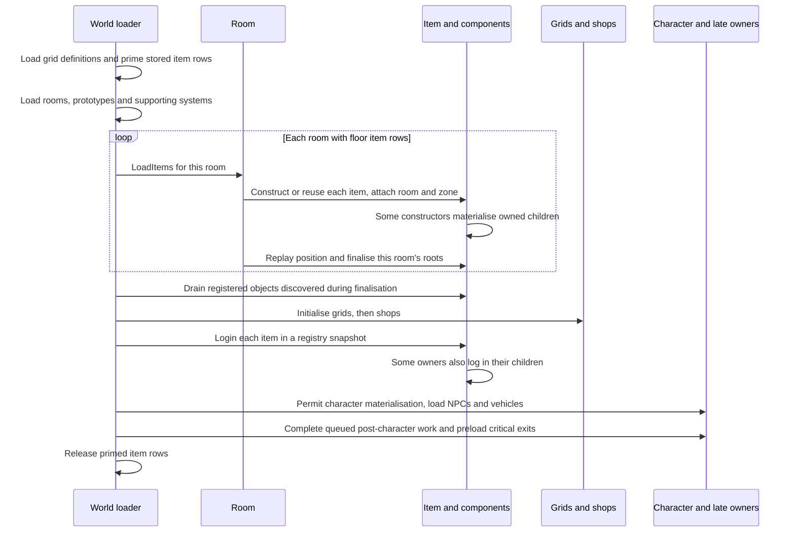
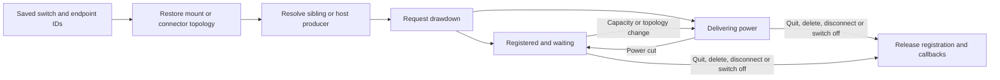

# Item and component lifecycle

A game item can have a database row, an entry in `Gameworld.Items`, a place in a room or body, and running callbacks. Each is a separate fact. For example, a held item can be durable while its character is offline, FutureProg can log in an item before assigning it a location, and a container can materialise another item while its own constructor is still running. A component that needs a room, sibling, character or power source must establish which of those facts its caller can actually supply.

This guide describes the engine paths. The [November 2026 review](Item_Lifecycle_Review_20261117.md) records the original defects and reproductions. The [remediation roadmap](Item_Lifecycle_Remediation_Roadmap.md) tracks implementation and verification.

## From prototype to running item

| Entry point | What happens before control returns | Who completes the lifecycle |
| --- | --- | --- |
| Ordinary `GameItemProto.CreateNew` | Builds a parent and calls each component prototype's `CreateNew`. Installs applicable default hooks, sets initial position, queues the parent for persistence, calls component `FinaliseLoad`, seeds the morph remainder and caches wound behaviour. Quantity, skin, variables and sizing are handled by the relevant overload. Prototype on-load progs can run here. | The caller registers, places and logs in the item and decides when to raise `ItemFinishedLoading`. Ordinary construction alone guarantees none of those four steps. |
| Builder `load` | Creates, adds, attempts to put the result in the builder's hand and otherwise places it at the builder. | Raises `ItemFinishedLoading`, then calls `Login`. An on-load prog has already seen the item before placement. |
| FutureProg `loaditem` | Creates and adds the item, raises `ItemFinishedLoading` and calls `Login`. | The calling prog supplies a destination afterwards. A component can receive both callbacks with no true location. |
| Copy, split or preview | The copy constructor calls each component's copy logic. A normal permanent copy adds itself to the world and runs component finalisation. A temporary preview suppresses persistence and registration and stays dormant. Non-temporary copies offer effects the opportunity to create a new effect. `DeepCopy` walks ordinary container contents. The severed-bodypart component reconstructs its own contents, implants, tattoos, wounds, and lodged items. | The split, bundle or other caller owns placement, login and events. For example, the commodity branch of `GetByWeight` logs in before raising `ItemFinishedLoading`. Each component defines what happens to children, stored energy and external links on copy. |
| Prepared currency and spell-created items | The special constructors stage components with saving suppressed and defer ordinary hooks/finalisation. The corresponding commit paths bind persistent identities and enable saving at their own publication boundary. | Use the owning operation's completion and rollback paths. Calling the ordinary creation sequence again can publish twice or expose uncommitted state. |
| Stored item row | Loads the exact item prototype ID **and revision**, then each stored component prototype ID and revision through `LoadComponent`. Restores parent fields, position, effects, surface liquid, hooks, wounds, resources and saved morph remainder. | Each root loader decides when to register, place, finalise and activate the resulting graph. Rehydration does not run prototype creation progs. |

The component manager resolves the stored component type when loading a **prototype**. That prototype constructs the individual component instance from its row and XML. A new instance's component constructor can see its parent, but the parent is still assembling its component list. Fresh and permanent copy constructors run the tracked component finalisation phase. The later graph pass skips completed component work. [Prototype factory](../../MudSharpCore/GameItems/GameItemComponentManager.cs) · [Item prototype](../../MudSharpCore/GameItems/GameItemProto.cs) · [Item constructors](../../MudSharpCore/GameItems/GameItem.cs) · [Builder load](../../MudSharpCore/Commands/Modules/BaseBuilderModule.cs) · [FutureProg load](../../MudSharpCore/FutureProg/Functions/GameItem/LoadItemFunction.cs) · [Spell creation](../../MudSharpCore/GameItems/GameItem.SpellCreation.cs)

Boot rejects a stored component prototype whose type name has no registered loader. The native item constructor also rejects an unknown item prototype revision, and expects each referenced component revision to resolve before calling its XML loader. Retain loaders for supported historical names and revisions. Defaults for missing XML fields and rejection of corrupt or contradictory references belong to the owning component. [Prototype loading](../../MudSharpCore/Framework/FuturemudLoaders.cs) · [Stored item constructor](../../MudSharpCore/GameItems/GameItem.cs)

### Identity and saving

The parent row stores item prototype and revision, condition, physical/runtime fields, ownership reference, container ID, effect XML and morph progress. Each component has its own row and primary key, parent item FK, prototype ID and revision, and instance definition. Room placement and body equipment have their own joins. Legal ownership, direct custody, derived spatial location and electrical membership answer different questions. A child inside a held bag can report the body's location without a direct body-equipment join. [Item row](../../MudsharpDatabaseLibrary/Models/GameItem.cs) · [Component row](../../MudsharpDatabaseLibrary/Models/GameItemComponent.cs) · [Inventory reconstruction](../../MudSharpCore/Body/Implementations/BodyInventory.cs)

For ordinary insertion, the save manager processes the parent's `First` phase before the components' default `Second` phase. `GameItem.DatabaseInsert` primes each component with the tracked parent row. The manager saves those rows, then publishes their generated IDs. An early read of a pending object's `Id` can flush the save manager. The world collection also supports pending identity through `IdRegistered`. Use a stable, already-assigned ID for cross-object XML, and avoid requesting a database identity from an incomplete object in a constructor, callback or diagnostic label. [Save phases](../../MudSharpCore/Framework/Save/SaveManager.cs) · [Identity access](../../MudSharpCore/Framework/Save/LateInitialisingItem.cs) · [World collection](../../MudSharpCore/Framework/All.cs) · [Parent insertion](../../MudSharpCore/GameItems/GameItem.cs) · [Component insertion](../../MudSharpCore/GameItems/GameItemComponent.cs)

The save queue tracks each saveable independently. Changing component XML generally requires marking that component changed. Changing the child's direct containment also concerns the child row, and changing room/body membership concerns its join owner. `_noSave` suppresses ordinary queuing during restoration. It does not prevent constructors, property setters, `InitialEffect`, normal connection events or external services from performing work. `RestorePersistedConnection` preserves prior dirty flags on the two components and their two parents on successful replay. Its scope does not include arbitrary observers invoked by the connection. [Component replay helper](../../MudSharpCore/GameItems/GameItemComponent.cs) · [Effect attachment](../../MudSharpCore/Effects/EffectHandler.cs)

Registration also updates services. The normal world `Add` path registers possession effects and media endpoints and asks an existing environmental exposure service to track the item. Stored-item lookup uses the same registration path when the caller opts in. Boot later refreshes environmental exposure. World `Destroy` forgets exposure, removes the registry entry, unregisters possession/media and destroys world listeners. A component's own heartbeat or another item's event list still has its own owner. [World indexes](../../MudSharpCore/Framework/Futuremud.cs) · [Boot refresh](../../MudSharpCore/Framework/FuturemudLoaders.cs)

## Cold boot and later materialisation



1. `PrimeGameItems` caches model rows including components, wounds, hooks, magic resources and room joins. This is a database read optimisation. It can contain items that will never become live during this boot. `TryGetItem` prefers a registered instance, then uses the primed row or a database lookup. An uncached instance is constructed **before** optional world registration. The default ID overload uses `addToGameworld = false`. Pending spell activation can prevent materialisation. [Lookup](../../MudSharpCore/Framework/Futuremud.cs) · [Prime and release](../../MudSharpCore/Framework/FuturemudLoaders.cs)
2. `LoadWorldItems` groups rows by their first room join. `Room.LoadItems` places a room's roots before replaying their position targets and calling `FinaliseLoadTimeTasks`. It skips an item already in a location, container or inventory and reports duplicate placement. Finalisers for the first room can run before roots in a later room have been placed. [Room staging](../../MudSharpCore/Construction/Room.cs)
3. `FinaliseWorldItemGraph` drains registered instances discovered by earlier finalisers. The item guards recursion and records each successful finaliser separately. A retry resumes at the failed component. Constructor recursion is guarded by the item ID under construction. Preserve unresolved references when a later load phase can supply their target. [Graph drain](../../MudSharpCore/Framework/FuturemudLoaders.cs) · [Item finalisation](../../MudSharpCore/GameItems/GameItem.cs)
4. Grids and shops initialise before the registry snapshot activates. `GameItem.Login` starts one active interval, visits current components and lodged items, restores cached schedules and calls each current effect once. Callbacks can move or retire the item. A throwing hook unwinds the entered component hooks in reverse before retry. Siblings and peers can activate at different times. [World activation](../../MudSharpCore/Framework/FuturemudLoaders.cs) · [Item activation](../../MudSharpCore/GameItems/GameItem.cs)
5. The character-materialisation gate opens after world items and room traps. NPCs, vehicles and their links/operations load, post-character tasks run, and critical exits are preloaded. Registrations made once materialisation is allowed during boot may complete immediately. For example, body remains defer an initial health tick to avoid resolving an original character too early. The gate guarantees permission to resolve a character. A consumer that requires a particular NPC, vehicle or another late service must check readiness of that dependency. [Boot order](../../MudSharpCore/Framework/FuturemudLoaders.cs) · [Post-character callbacks](../../MudSharpCore/Framework/Futuremud.cs)

### Other roots

| Root | How it restores its graph | Consequence for authors |
| --- | --- | --- |
| Body | `LoadInventory` reads equipped order, reconstructs held, worn and wielded state, then finalises the batch. Failed fitting may put an item on the floor. Prosthetics, implants and wound-lodged items have additional load paths. `Body.Login` and `Quit` traverse `AllItems`, which includes those categories. Dormant forms have explicit item lifecycle methods. | Attaching to a body, becoming the active body and entering the game are separate transitions. The body is responsible for its roots. Components own traversal beyond them. [Body](../../MudSharpCore/Body/Implementations/Body.cs) · [Inventory](../../MudSharpCore/Body/Implementations/BodyInventory.cs) · [Implants](../../MudSharpCore/Body/Implementations/BodyParts.cs) |
| Installed door | `Exit.PostLoadTasks` looks up the door item, sets both ends of the exit installation, finalises, checks retirement and logs it in. | A door can have two true rooms and no floor-item join. Use the installed exit when identifying it. [Exit loader](../../MudSharpCore/Construction/Boundary/Exit.cs) |
| Auction listing | Auction-only items materialise and structurally finalise in post-character loading. Listing suspends active-time clocks and callbacks throughout owned contents. Absolute deadlines retain their authored expiry. Claim and cancellation place the asset in custody before activating it. | Exercise an asset reachable only through the listing and inspect both ends of nested custody after retrieval. [Auction house](../../MudSharpCore/Economy/Auctions/AuctionHouse.cs) · [Claim and cancellation](../../MudSharpCore/Commands/Modules/EconomyModule.cs) |
| Active craft | A simple reserved input is detached and explicitly quit. Its item IDs are stored by the input data. The active craft forwards structural finalisation. Products that release reserved inputs have their own publication/login path. | An input can intentionally stay suspended throughout a craft. Activate it at the operation that releases it. Test legacy single-input XML as well as lists. [Input custody](../../MudSharpCore/Work/Crafts/Inputs/BaseInput.cs) · [Active craft](../../MudSharpCore/GameItems/Components/ActiveCraftGameItemComponent.cs) · [Unused input release](../../MudSharpCore/Work/Crafts/Products/UnusedInputProduct.cs) |
| Remains and idle loading | Database-loaded body parts and final-death corpses enqueue lazy work for original references. The save manager drains lazy work within an idle-time budget. Reading an original character/body can resolve it earlier. Both components start decay listeners on activation. A corpse that overrides wound behaviour waits for post-character readiness before starting its health tick if it is active. | Idle loading, structural finalisation, post-character readiness and activation are distinct. Avoid forcing original-character resolution from rendering, a save label or an early callback. [Corpse](../../MudSharpCore/GameItems/Components/CorpseGameItemComponent.cs) · [Body part](../../MudSharpCore/GameItems/Components/BodypartGameItemComponent.cs) · [Idle loader](../../MudSharpCore/Framework/Save/SaveManager.cs) |
| Ad hoc lookup | `TryGetItem` returns an existing registered object or constructs one, optionally registering it. Lookup does not run the item graph finaliser or item login. Instance constructors can still install listeners. | Choose who owns the returned instance, whether it should become active and when to release it. A detached lookup can later coexist with a registered instance bearing the same ID. [Lookup and world removal](../../MudSharpCore/Framework/Futuremud.cs) |

## Relationships and power

| Relationship | Stored evidence and reconstruction | Lifecycle responsibility |
| --- | --- | --- |
| Owned contents, locks, magazines, chambers | A parent's XML may name a child item while the child row carries `ContainerId`. The component checks the stored and current custody before restoring the relationship. | An owning component must reconstruct both ends and forward the appropriate **whole-item** lifecycle. Decide whether death/morph transfers, drops or consumes the child. Check parent and child state before destructive cleanup. [Container](../../MudSharpCore/GameItems/Components/ContainerGameItemComponent.cs) · [Magazine](../../MudSharpCore/GameItems/Components/InternalMagazineGunGameItemComponent.cs) |
| Belt and mounted module | A belt restores `Connected` item IDs and sets the beltable reverse pointer. An automation host records bay and item identity, resolves a compatible mountable in `FinaliseLoad`, and forwards lifecycle calls to distinct module parents. | The mount relationship can supply both physical location and access to a power source. A change in either end can invalidate derived subscriptions. [Belt](../../MudSharpCore/GameItems/Components/BeltGameItemComponent.cs) · [Mount host](../../MudSharpCore/GameItems/Components/AutomationMountHostGameItemComponent.cs) |
| Connector peer | Standard links record the peer item ID, connector descriptor, independence and the physical port IDs at both ends when available. Independent replay uses registered, colocated peers. A dependent peer may be materialised and recursively finalised. Normal `Connect` chooses compatible free connectors, updates both endpoints and fires connection events. | A physical peer may have a different owner. Disconnection releases both endpoints and preserves an independent peer. The port IDs must identify one compatible pair among the candidate components. [Connectable](../../MudSharpCore/GameItems/Components/ConnectableGameItemComponent.cs) |
| Cross-world reference | An effect, shop, auction, corpse or grid can refer to an object whose owner loads later or whose ID belongs to another table. A body, component, parent item and owner character each have independent identities. | Preserve unresolved keys where late resolution is expected. Assign an explicit phase or event for retry, and validate type, membership and identity when the target arrives. [Electrical grid](../../MudSharpCore/Construction/Grids/ElectricalGrid.cs) · [Corpse](../../MudSharpCore/GameItems/Components/CorpseGameItemComponent.cs) |

Boot indexes forward claims by the exact component prototype revision. It covers containers and locks on ordinary, locking, refrigerated, implant, folded-pocket and dryer containers, automation housings, charged and battery-powered assemblies, and generator locks. It also covers clips, piles, severed remains, firearms, sheaths, belts and tables, as well as washers, cash registers, fax machines, photocopiers and shop stalls. A shop's association with its stall and a communications machine's peer links have their own lifecycle. Room, body and wound custody take precedence. A populated reverse container key settles conflicting forward claims unless their ownership leads to a cycle. The engine holds ambiguous or cyclic relationships, leaves the child row intact and preserves the original forward XML, including attributes such as firearm attachment slots, on later component saves. The boot report identifies the affected items and claimants. A subsequent boot re-evaluates repaired storage. [Legacy custody](../../MudSharpCore/GameItems/LegacyItemCustody.cs)

Severed-bodypart copies share anatomical prototypes and references to the original character and body. They get their own items, tattoos and wound records. A cloned wound belongs to the copied item, and a lodged object belongs to that wound. Active infection objects belong to living-body health state and are excluded from the copy. The remains component assigns copied contents directly because its normal player-facing insertion path forbids putting objects into a severed part. Permanent wound records are allocated after item IDs are available. The remains component reuses the item's loaded wound so deletion and replantation act on the same object. [Severed bodypart](../../MudSharpCore/GameItems/Components/BodypartGameItemComponent.cs) · [Wound factory](../../MudSharpCore/Health/WoundFactory.cs)

A powered item has at least three states to reason about independently. Its switch expresses intent. A producer may have registered it as a consumer waiting for capacity. `OnPowerCutIn` indicates actual delivery and can start a machine, subscribe to signals, run a prog or emit an emote. `OnPowerCutOut` ends delivery. A producer may retain a waiting consumer across a cut. Only an explicit end of registration releases that relationship.



`PoweredMachineBase` keeps track of the registered producer through a cut, releases it even while waiting, and restores topology subscriptions at login. `PowerSocket` validates its primary sibling at prototype submission and at activation. Electrical grids read legacy component IDs in the component namespace and write parent item plus component IDs for resolved endpoints. Feeders and outlets join on activation. Generic connectors, power sockets, battery assemblies, compressors, cannulas, drips, IV bags and external organs retain unresolved links and use exact local ports and reciprocal evidence. Replay without a reciprocal record requires an unambiguous remote match. Attachable connectors resolve historical peer IDs in the component namespace and include the parent item ID in new saves. Named automation bays resolve their own mount relationship. Power banks suspend upstream draw and charge changes at quit and resume waiting downstream consumers at activation. [Power lifecycle](../../MudSharpCore/GameItems/Components/PoweredMachineBaseGameItemComponent.cs) · [Connector replay](../../MudSharpCore/GameItems/GameItemComponent.cs) · [Attachable connectors](../../MudSharpCore/GameItems/Components/AttachableConnectableGameItemComponent.cs) · [Electrical grid](../../MudSharpCore/Construction/Grids/ElectricalGrid.cs)

Prototype connector definitions persist an ID for each physical port. Retaining that ID across edits lets an existing link survive a reorder. Loading an older prototype derives the initial identities from the prototype ID, descriptor and occurrence of identical descriptors. Those identities let a subsequently established link track the physical port. A historical link that recorded only a descriptor stays pending if several ports could be its original endpoint. A standard two-sided connection captures both ports and stores a separate reciprocal identity on each live link. Its item observers run after both endpoints register, so a reentrant observer sees each selected port occupied. Named mounts and other specialised attachment protocols continue to manage their own relationships. [Connector identity](../../FutureMUDLibrary/GameItems/Interfaces/IConnectable.cs) · [Connection persistence](../../MudSharpCore/GameItems/GameItemComponent.cs)

Fuel and unlimited generators load the saved switch as passive configuration. Login starts output and its heartbeat once. Quit keeps the switch position, withdraws existing output and releases the heartbeat. Delete also drops the unlimited generator's retained consumer registrations. [Fuel generator](../../MudSharpCore/GameItems/Components/FuelGeneratorGameItemComponent.cs) · [Unlimited generator](../../MudSharpCore/GameItems/Components/UnlimitedGeneratorGameItemComponent.cs)

## Effects, decay and time

During database reconstruction, `LoadEffects` creates effects through the registered factory, drops entries reporting load errors and caches resumable durations. Attaching an effect runs `InitialEffect`. At item login the engine restores each cached schedule before calling its effect. An effect with its own deadline can then replace or remove the restored schedule. [Perceived item](../../MudSharpCore/Framework/PerceivedItem.cs) · [Effect handler](../../MudSharpCore/Effects/EffectHandler.cs)

| Clock contract | Durable state | Behaviour across absence |
| --- | --- | --- |
| Generic saving effect | Type, applicability prog, definition and remaining milliseconds in `EffectData`. A schedule flag distinguishes a due schedule from an unscheduled effect. | Quit caches and unlinks the schedule. Login restores even a zero remainder when the entry carries the flag. Historical unmarked zero retains its old meaning. `SavingEffect` controls cold persistence. [Effect encoding](../../MudSharpCore/Effects/Effect.cs) · [Effect scheduler](../../MudSharpCore/Effects/EffectScheduler.cs) |
| Item morph | Whole effective seconds in `MorphTimeRemaining`. While active, the scheduler holds a deadline and a 30-second dirtying schedule. | Quit retains effective time left. Login converts it to wall time at the current rate. Zero remainder schedules the next possible tick. Negative legacy values load as 60 seconds. A null remainder does not start a new timer. Refrigeration-sensitive morphs retain progress while a rate pauses them or a deadline cannot be represented. [Morph and save](../../MudSharpCore/GameItems/GameItem.cs) · [Time-rate math](../../FutureMUDLibrary/GameItems/Interfaces/IItemTimeRateModifier.cs) |
| Torch or fuse | `Lit` and `RemainingFuel` or `BurnTimeRemaining`. | Each live second heartbeat consumes one unit/second. Quit and delete detach the listener. Offline wall time does not burn the saved remainder. [Torch](../../MudSharpCore/GameItems/Components/TorchGameItemComponent.cs) · [Fuse](../../MudSharpCore/GameItems/Components/FuseGameItemComponent.cs) |
| Armed deadline | Countdown and pin-pull triggers persist UTC deadline ticks. Clock detonators persist a game-clock instant. | An overdue UTC trigger checks immediately on login. The game-clock trigger compares against its authored clock. This is why a login hook can delete its own item during traversal. [Deadline trigger](../../MudSharpCore/GameItems/Components/DeadlineExplosiveTriggerGameItemComponent.cs) · [Clock detonator](../../MudSharpCore/GameItems/Components/ClockDetonatorGameItemComponent.cs) |
| Corpse or severed part | Decay points and stage. An in-memory UTC anchor measures time between resolutions. | A minute heartbeat settles elapsed live time at the terrain and biological-decay rate. Starting the listener sets a fresh anchor. Quit/delete release it. Corpse preservation and unavailable location can suppress accrual. Parts and corpses have separate implementations. [Corpse](../../MudSharpCore/GameItems/Components/CorpseGameItemComponent.cs) · [Body part](../../MudSharpCore/GameItems/Components/BodypartGameItemComponent.cs) |
| Prepared food and perishable liquid | Effective age and last UTC resolution. Food also stores creation time. Liquid instances carry freshness stage and per-instance age. | A later resolution includes elapsed wall time, scaled by the applicable rate. Placement, container opening and power can change the multiplier. Settle elapsed time under the old conditions before applying new ones. Cold reconstruction can know only the context available when it resolves the interval. [Prepared food](../../MudSharpCore/GameItems/Components/PreparedFoodGameItemComponent.cs) · [Liquid age](../../FutureMUDLibrary/Form/Material/LiquidInstance.cs) · [Refrigerator](../../MudSharpCore/GameItems/Components/RefrigeratorGameItemComponent.cs) |
| Incense burner and ambient scent | The burner saves its lit state, current fuel and remaining burn time. The room saves each scent as a timed effect with plain source and scent text and a separate colour field. | The burner refreshes its scent and consumes fuel on its active heartbeat. Quit releases the subscription, and login resumes the saved state. Existing scents expire according to their room effect schedule. [Incense burner](../../MudSharpCore/GameItems/Components/IncenseBurnerGameItemComponent.cs) · [Ambient scent](../../MudSharpCore/Effects/Concrete/AmbientScent.cs) |
| Item wounds | Wound rows, lodged-item references and an item or component-provided health strategy. | The normal item strategy is event-driven. Activation starts a periodic strategy when the item has wounds and requires a tick. Corpse wound handling can forward to the original body after character loading. Ordinary item quit ends health ticks. Do not attach a periodic wound listener to every healthy item. [Item health](../../MudSharpCore/GameItems/GameItemHealth.cs) · [Native item strategy](../../MudSharpCore/Health/Strategies/GameItemHealthStrategy.cs) |

For rate-scaled ageing, the first enclosing component providing a rate for that process wins. The search walks outward from `ContainedIn`, defaults to 1, and does not multiply every enclosing modifier. Normal containment changes settle the moving item's graph before and after changing parent. `LoadTimeSetContainedIn` assigns the field directly. A cold graph therefore needs a deliberate point for its first time resolution. Corpse/part decay also dirties progress at threshold intervals, so the latest in-memory decay points can be ahead of the last saved row. [Rate selection](../../FutureMUDLibrary/GameItems/Interfaces/IItemTimeRateModifier.cs) · [Containment changes](../../MudSharpCore/GameItems/GameItem.cs) · [Decay checkpoints](../../MudSharpCore/GameItems/Components/CorpseGameItemComponent.cs)

## Leaving play, replacement and deletion

**Quit.** A transient logout policy may retire the item. Ordinary suspension ends the health tick, caches effect and morph progress, flushes dirty state and releases position and perceivable events. It detaches direct spatial context, quits components and wound-lodged items, removes effect schedules and unregisters the exact instance. Auction suspension keeps the detached asset registered and preserves nested custody. Components release their own heartbeats, subscriptions and power registrations. [Item quit](../../MudSharpCore/GameItems/GameItem.cs)

**Server shutdown.** The staff shutdown path dirties character effects and flushes. On normal game-loop exit the engine materialises outstanding route motion and flushes queued work. It does not walk every world item through `Quit`. A cold restart therefore uses the last durable component/timer state. A component that saves progress only in `Quit` can behave differently on character logout and server restart. [Staff shutdown](../../MudSharpCore/Commands/Modules/StaffModule.cs) · [Game loop](../../MudSharpCore/Framework/Futuremud.cs) · [Server lifecycle](../../MudSharpCore/Server/Main.cs)

**Death and morph.** Damage death calls `OnDeath` before constructing the replacement. Timed morph offers effects a transfer before running component hooks. Both paths run `HandleDieOrMorph` in `ComponentDieOrder` before default placement. If a hook places the replacement, later placement hooks respect the committed custody. If no hook places it, the engine tries to swap it into the source's container or body slot. A remaining detached replacement falls back to the captured room, layer and route coordinate after the source retires. The surviving replacement is added to the world registry before `Login`. `ItemFinishedLoading` follows only while the replacement remains active. Reentry during replacement cannot start a second replacement for the same source. [Damage death](../../MudSharpCore/GameItems/GameItemHealth.cs) · [Morph](../../MudSharpCore/GameItems/GameItem.cs)

**Delete.** A persisted graph of ordinary and locking containers, clips, piles and supported leaf components can commit in one child-first transaction. The graph can include native item-owned wounds and their exact lodged items when the wounds have no infection and the items qualify. The engine first saves existing custody changes, then compares the loaded graph with reverse containment, direct custody, and the complete wound and lodging records. Any unaccounted child, misplaced wound or competing lodging stops the transaction before teardown. MySQL must accept the entire delete before runtime cleanup. A refused transaction leaves the parent, children and wound rows available after restart. [Native transaction](../../MudSharpCore/GameItems/GameItem.NativeDeletion.cs)

Other persisted native deletions can invoke observers and components that do their own durable work. For those deletions the engine writes `GameItems.NativeDeletionStage` before callbacks, runs teardown and flushes its saves, then records that only the final row transaction remains. Startup checks these stages before it materialises items, inventories or rooms. It finishes a completed checkpoint using only database cleanup and foreign keys. A provider refusal at that stage can be retried after the provider issue is resolved. Spell ownership, auction custody, committed currency and stack operations, and callers running inside an existing database transaction use their own contracts. [Native removal](../../MudSharpCore/GameItems/GameItem.cs) · [Spell-owned removal](../../MudSharpCore/GameItems/GameItem.SpellRemoval.cs)

| Stored stage | Recovery |
| --- | --- |
| `NULL` | Ordinary item. Standard boot applies. |
| `1` (`TeardownInProgress`) | The process may have stopped before, during or after a callback. Startup stops before materialising world state and reports the item IDs. Inspect the error, child custody, and any affected external records against a backup or audit trail. Restore a consistent pre-delete state or establish that cleanup completed before resetting its stage or advancing it to `2`. |
| `2` (`ReadyToDelete`) | Observers, component and wound teardown, effect removal and custody cleanup finished, and the save manager flushed. Startup retries the final transaction, including disabling hitch links, without replaying callbacks. |

An interruption can leave the outcome of an external callback unknown even with a checkpoint. A component that needs automatic recovery across that boundary should give its operation an idempotent durable key or commit the related changes together. [Recovery implementation](../../MudSharpCore/GameItems/GameItem.NativeDeletion.cs)

When startup reports an unknown outcome, capture the listed item IDs and the original fatal report before restoring or advancing any checkpoint. The item and wound rows show which ownership edges survived. Resolve held component XML and external records, such as shop transactions or retired-body state, against the specific callback and a known-good backup. These queries provide a starting point for a single affected item.

```sql
SELECT Id, ContainerId, NativeDeletionStage
FROM GameItems WHERE Id = @item_id OR ContainerId = @item_id;

SELECT Id, GameItemId, BodyId, LodgedItemId, WoundType
FROM Wounds WHERE GameItemId = @item_id OR LodgedItemId = @item_id;

SELECT Id, GameItemComponentProtoId, GameItemComponentProtoRevision, Definition
FROM GameItemComponents WHERE GameItemId = @item_id;
```

If the evidence establishes a consistent pre-delete graph, restore that graph before returning it to service. If it establishes completed teardown, the completed checkpoint allows the normal boot transaction to finish. Keep the hold when either conclusion would require guessing about a child or an external side effect.

## Implementing a lifecycle-bearing component

1. **Write down what it owns.** For each child, peer, listener or registration, identify the durable key, its ID namespace, the owning end, how the reverse reference is rebuilt and who releases it. A socket peer, lock item and grid have different deletion policies.
2. **Specify the earliest valid world context.** Parse local XML in the constructor. Resolve peer and sibling relationships when available. Activate gameplay once placement, policy and dependencies permit it. Use a later service callback for characters or other post-item dependencies. A diagnostic description or a public property setter can resolve an entity or run a prog.
3. **Make replay safe when work is repeated or interrupted.** Separate pending, successfully resolved, invalid and retired references. Preserve a repair that was already dirty before load. Break constructor-time ownership cycles by ID. During graph traversal use object identity for the current pass and mark recursion before following peers. Record failure separately from completion.
4. **Distinguish registration from delivery.** For power track the producer actually registered with, the switch, whether power is being received, and retry/listener ownership. Pair every begin/subscribe with exactly one end/unsubscribe, including while waiting for capacity. Restore subscriptions on a same-instance relogin.
5. **Choose the clock and save boundary explicitly.** Decide what one hour offline does. Persist a remainder for active-time behaviour, a deadline for real-time expiry, or effective age and a timestamp for rate-scaled ageing. Specify precision, zero, overdue, unknown legacy state and which operation marks the correct saveable dirty.
6. **Expect callbacks to change the graph.** Snapshot collections before invoking children. After a prog, power callback, detonation, merge or expiry, recheck that both participants still exist and still have the expected custody before continuing. Dispose external registrations on direct delete as well as quit. Do not assume delete is preceded by quit.
7. **Exercise more than fresh creation.** Compare a floor root, an inventory root, a nested child and a late-only root. Force item IDs and component IDs to differ. Include a temporary copy, lost peer, duplicate login, quit twice, same-object relogin, fresh-object reload, delete while active and a callback that removes itself. Check database rows, actual registry identity, endpoint membership, callback count and elapsed time separately.
