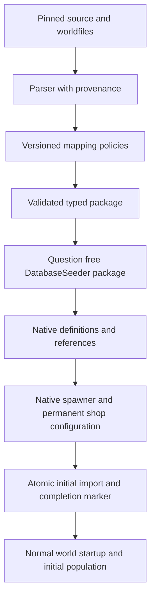

# Armageddon Worldfile Seeder Design

Status: implemented and locally qualified, 26 October 2026. The question-free one-shot seeder is enabled; broader test-suite limitations are recorded below. Confirmed requirements include no seeder questions, native spawners/progs/hooks, Vnum unique names, HP health, native combat-formula conversion, single-phase crafts, 0% forage yield consumption, permanent native shops, one-shot installation and no source zone-activation gate. The implementation details and remaining limitations below distinguish active mappings from archived source behaviour.

## Purpose and installation contract

Add an optional **Armageddon Worldfile** package to DatabaseSeeder that installs a configured historical world into an already prepared FutureMUD database: rooms, item prototypes, crafts, NPC templates, NPC and item loaders, foraging, live clans, economy and shops. Preserve authored identities, descriptions, relationships and distributions wherever FutureMUD can represent them. Use native FutureMUD gameplay for bodies, injuries, combat, crafting, inventory, money and commerce, with explicit adaptations where the engines differ.

The package asks **no configuration questions**. `ArmageddonWorldfileSeeder` exposes an empty `SeederQuestions` sequence and no source-directory, region, fidelity, reset, economy or rerun prompts. Selecting the package runs assessment, validation and installation using its versioned configuration. Normal DatabaseSeeder connection and menu selection remain installer operations. Missing prerequisites or conflicting identities produce actionable failures, never a questionnaire.

This is a world-content package layered on the Armageddon setting foundations. It does not create accounts or players, change the selected progression, enable unavailable chargen races, move existing characters or replace the starting location. Accounts, private mail/notes, logs, player inventories, live clan balances and historical shop transactions are excluded. Authored NPC starting money is in scope; archived live NPC inventories and balances are not.

## Source package and fidelity

### Source identity

The supplied Spaces folder is [ArmSolo](chatgpt-library-folder://6add7a2135c48191b9d0186a1227160d/), described in chat as Armageddon Worldfiles. The qualified local candidate is `C:\Users\luker\Downloads\ArmSolo_Platypus Version-2024.08\ArmSolo`. All 415 admitted Library filenames and sizes match the local manifest, but the Library connector could not materialize bytes for a hash comparison. Uploaded-folder byte equality remains unverified. Do not mix this candidate's tables with an unrelated `codedump.c` or current live-game information.

The candidate contains 81 files in each of `areas/*.wld`, `objects/*.obj`, `npcs/*.npc`, `cmds/*.cmd` and `background/*.bdesc`, excluding backups. Supporting files include `data_files/zones`, `races`, `guilds`, `subguilds`, `crafting.xml`, `forage`, `clans`, `cities` and `shops`. The sequential parser finds 26,137 rooms, 7,418 raw item records (7,415 effective vnums), 2,475 raw NPC records (2,460 effective vnums), and 27,682 reset commands. See the [format reference and corpus audit](Armageddon_Worldfile_Format_Reference.md) for lexical rules, all 41 item value layouts, source code mappings and effective defect dispositions.

The 415 admitted public data files have been compared byte for byte with the local archive. Two broken exits are omitted by the historical loader; three population reset references and eight boot-only door commands refer to absent entities/rooms. First-loaded definitions win duplicate prototype vnums. The one sample craft is unusable because success output 6 is missing; do not invent a product. Source shop arrays need 21 explicit, audited repairs before their declared 173 records can be translated. Raw data and repairs remain separate. These are source qualification results, not native import acceptance.

| Candidate file | SHA256 |
| --- | --- |
| `db.c` | `70cd96804c4c932e08b1d772b1445936a1a06d9b69c1194ff483b7dfea367dc5` |
| `core_structs.h` | `c39a953310ce40f2a3d92c1321d106dd57fc66df341b0847e186995fa7b36c88` |
| `barter.c` | `77061ff3fd77b122d4fe4d737b471045fc688b929deeb88a9a88e7b54b5682d5` |

The release manifest must hash every admitted data file and script body, record encoding/source-relative paths, and list exclusions. Backups do not become competing definitions. Keep raw fields and source line/record locations beside translated data. Preserve signed flag bit 31 as its original 32-bit mask.

### Conversion outcomes

Every source record and behaviour-bearing field receives one disposition:

| Disposition | Meaning |
| --- | --- |
| Native | The target expresses the same authored relationship or operation. |
| Adapted | A documented conversion changes units, rules or balance to fit FutureMUD. |
| New capability required | A reusable engine or persistence feature is needed. |
| Archive only | Raw data survives, but this part has no active behaviour. |
| Excluded | Outside the native installation, with a reason; raw archive provenance remains available. |
| Invalid source | Broken or ambiguous data needs a reviewed correction or exclusion. |

Archive-only content is not counted as functioning world content. Essential references in imported rooms, recipes, loader progs and shops must resolve before the completed package becomes available. A nonessential missing historical program can remain archive-only if the manifest names the resulting behaviour loss. Do not silently substitute an empty prop, Human NPC, generic coin, unlocked door or unrestricted recipe and report faithful conversion.

Preserve raw values separately from effective source-loader values. The object loader, for example, accepts legacy four-field and current five-field type headers, resets temperature and repairs some armour defaults. Compare against effective historical behaviour without copying memory errors, array-bound bugs or unsafe parsers into FutureMUD.

## Package architecture and fixed configuration

### Build once and install configured content

A development-time Armageddon parser and translator generates a validated typed world package. Ship this package with DatabaseSeeder: installation must not access Spaces, Downloads, a browser, arbitrary paths or the network. A source/hash or translation-policy change produces a new package version and review report.

| Proposed location | Responsibility |
| --- | --- |
| `DatabaseSeeder/Seeders/ArmageddonWorldfileSeeder/` | Public seeder, assessment, orchestration, bindings and domain installers. |
| `DatabaseSeeder/Assets/Manifests/ArmageddonWorldfiles.manifest.json` | Corpus identity, source hashes, record inventory and source-defect dispositions. |
| Private `FUTUREMUD_ARMAGEDDON_DATA_DIRECTORY` | External, hash-validated typed package and special-text inputs; never embedded, committed or shipped. |
| `scripts/armageddon-worldfile-package.py` | Sequential legacy parsing/provenance and deterministic package generation; no dependency on the SOI converter CLI. |
| Library, Core and persistence projects | Approved shared contracts, native runtime capabilities and schema additions. |

The RPI converter offers useful parse/transform/validate/apply patterns. Its SOI parsers, enums, unit factors and Middle-earth assumptions do not apply to Armageddon. Extract genuinely shared target writers where useful. `ItemSeeder.InstallCatalogueItem` and `InstallCatalogueCraft` are private instance helpers, not public importer APIs: reuse requires a bounded extraction or a dedicated writer, preserving each package's ownership.

### Proposed fixed configuration

Numeric calibrations still unresolved in this draft must become reviewed manifest values before release. They never become installer questions.

| Setting | Proposed rule |
| --- | --- |
| Source | One pinned corpus and translation-policy version. |
| Definitions | All valid definitions in admitted files, including vnum 0 through identity mapping. |
| Source zone-open flag | Provenance only. Import valid in-scope records into ordinary FutureMUD zones; do not create a zone-activation feature or inherit the source flag as a gate on other imports. |
| Spatial grouping | Use the installed native shard with one target zone per source zone; city/economic grouping is separate. |
| IDs | Native allocation plus typed external keys; no source integer reservation across target tables. |
| Names and prose | Preserve player-facing wording with deliberate markup translation; package labels belong in provenance. |
| Mechanics | Existing HP health model for imported NPCs, native weapon/armour formulas, native crafting and currency. No requirement to qualify imported content against the complex health model. |
| Currency | Dedicated source monetary identity and decimal conversion scale; no opportunistic generic currency. |
| Missing dependencies | Block essential unresolved bindings before mutation. |
| Population | Native NPCSpawners and scheduled progs/hooks, with one owner per population; historical zone-open state is not an activation gate. |
| Reruns | One-shot setting creation. Refuse a second successful installation before mutation; no update, reconcile or upsert mode. |
| Programs | Individual reviewed mappings; no automatic C, DMPL or JavaScript execution. |
| Corrections | Explicit original/replacement/reason records; no hidden heuristics. |

### Dependencies and replay

Use reflection-discovered `IDatabaseSeeder`, metadata dependencies and authoritative database predicates. `ArmageddonSettingSeeder` supplies setting-specific skill, heritage, role, language, combat and magic identities. Its existing dependencies compose Core, Time, attributes/skills, Human, Combat and Chargen. Do not create a contradictory foundation installer.

The admitted wildlife may need additional races, bodies and AI. Reuse matching definitions and create content where absent. Imported NPCs use the existing HP model through per-template health-strategy overrides, not a replacement of shared player-race health defaults. Require concrete consumed bindings rather than every optional seeder. Economy/currency foundations can be explicit providers or minimal dedicated content. Bind the shard to compatible Armageddon time/weather/sky; resolve one builder-account identity for initial approval metadata.

Strict Debug replay inventories include every enabled seeder exactly once. Shared NotApplicable dispositions require both a reason and a live-context predicate: Earth profiles explicitly omit this setting-specific world, while the armageddon-native profile executes it after Psionics. That profile also marks the generic ItemSeeder not applicable because its era recipes require skills such as Pottery that the Armageddon skill package does not install. All declared question IDs remain in each authored profile, including inactive questions; the Worldfile seeder itself declares none. NotApplicable steps are reported separately from completed installs.

## Identity ownership and execution

Use `UniqueName = "Vnum<number>"` on imported item prototypes, NPC templates and rooms: source vnum 13352 becomes `Vnum13352`, and vnum 0 becomes `Vnum0`. These are separate namespaces, so the same text can identify an item, an NPC template and a room. Preserve display names. Keep typed source keys such as `arm.world.item.13352` and allocated native IDs/revisions for reference wiring and provenance. These mappings support the one-time import and generated progs, not an update/upsert contract.

Recipes without source IDs and reset instructions need reviewed stable identities with a retained source locator map. Line numbers and content hashes alone are unstable when lines are inserted or corrected. Validate source zone headers against actual positional/file semantics: the candidate scans header numbers but populates the zone table sequentially.

An object loaded with reset overrides remains linked to its base source identity. Prefer native instance configuration; where unavailable, use a stable derived prototype keyed to the reset action. Never mutate a base prototype because one loader changes its values or prose. Contextual NPC variants likewise retain their common mobile identity for shared caps.

Do not adopt existing same-name or same-unique-name rows as imported entities. Dependencies on existing setting definitions are resolved explicitly; imported content is newly created. Detect collisions, duplicate source keys and ambiguous bindings before mutation. A package completion marker and source digest identify the completed import.

Confirmed metadata is `OneShot`, update capability `None`, and `SafeToRunMoreThanOnce = false`. Assessment must report installation state honestly, and SeedData itself must refuse a completed package before any write; menu warnings alone are insufficient. Store completion/provenance records only as needed. No field baselines, three-way reconciliation, repair-existing, retirement reconciliation, revision refresh or builder-edit merging are required.

A successful import is not rerunnable. Runtime NPC/item replenishment, onload setup and server restart are separate and still need duplicate-safe native logic; refusing the seeder twice must not disable ordinary population maintenance.

Preflight the complete package and bindings before mutation, then use one transaction on the supplied context for the initial definitions, relationships and completion marker. Intermediate SaveChanges may obtain IDs without independent commits. Do not call helpers that create independent transactions and imply atomicity. On failure, roll back the attempted import and leave foundations intact; a corrected attempt after full rollback is initial creation, not an update mode. Do not add partial-install resume/upsert infrastructure. The completed marker and reported result must agree with the committed package.

## Implemented configuration and qualification boundary

The current writer creates definitions in one relational transaction, compiles generated progs with the native compiler, and commits its completion marker with the imported graph. It asks no questions and refuses a completed install on direct calls as well as through assessment. A failed import rolls back; it does not leave an update/resume mode in the product.

| Domain | Current configured mapping |
| --- | --- |
| Rooms | One zone per source zone on the installed native shard; approved overlays, reciprocal-compatible or one-way exits, installed keyed doors, deterministic reconstructed coordinates. Source city fields remain authoritative; every room in this corpus has city 0. |
| Inspection | Reusable native keyword-description item component and saving room effect. Ordinary look targets retain precedence; contextual inspection and `look <keyword> on <item>` use normal visibility. Long prose is preserved in component/effect XML. |
| Items | Source vnums retain base `Vnum<n>` identities; reset variants preserve six effective values, source light/armour reset exceptions, size-adjusted clothing weight, key patterns, light state, native capacities and starting currency amounts. Unqualified magic, poison, vehicle and other special behaviour is explicitly archived. |
| Combat | Melee and projectile attack expressions preserve source bonus plus dice; native attack traits, timing and defenses remain. Arrow/bolt flags create native ammunition and bow, crossbow, sling and blowgun identities select the native ranged family. Armour uses expected source AP/10 absorption in native physical-damage formulas. Native condition, penetration and type transformations remain; stochastic source wear is an approximation. NPC offence, defence, innate armour and damroll scalars remain provenance rather than equivalent native bonuses. |
| NPC health | Per-template BrainHitpoints overrides use literal source maximum HP. Body construction retains an explicit template strategy; null still uses the race default. Heart/hypoxia checks and critical-injury knockouts are disabled for these strategies; shared player races keep their health settings. |
| NPC bodies | NPC-only race derivatives preserve native baseline racial anatomy and add an existing non-unary Grabbing inventory part where needed. Their maximum-lift expression is set to the engine's largest finite weight, making carried inventory effectively unrestricted without changing player races or attributes. Native Get and reconstruction prefer eligible non-unary slots, and an occupied inventory slot accepts additional goods, leaving physical hands available for weapons. Copied defaulted race scalars are explicitly preserved after insertion, including false breathing flags and zero rates, so database insertion defaults cannot change the chosen baseline. Every derivative has a native ethnicity, including a minimal unavailable NPC population where its anatomy baseline lacks one. No visible pack or new inventory subsystem is introduced. Native worn/wielded equipment fit remains separate. |
| NPC dimensions/language | Exact means of source race height/weight generators, including C integer division, convert inches and ten-stone weight units separately. Source language indices map by name to installed setting languages; unavailable/invalid languages receive an explicit recorded fallback. |
| Clothing | Different allowed wear flags are alternative profiles. Rings, wrists, ankles and shoulders have separate side/location profiles; reset E slots select the corresponding native profile or wield/belt placement. E forces its explicit source slot even without a matching normal wear flag, so a missing native location becomes a reset-specific wearable variant. Keys and money retain their ordinary wear flags alongside their typed components. |
| Liquids | Explicit calibration of 50 mL per abstract source unit, preserving clamped initial fill fraction. Native liquid identities are a semantic crosswalk; regional beverage flavour, spice and poison are not claimed equivalent. Native `setliquid` has a volume overload for partial initial contents. |
| Population | Boot room hooks, scheduled progs and NPCSpawners compose the reset mapping. Each mode-2 M spawner has its authored room and counts the whole source prototype family. Native polling fills a deficit; it does not reproduce one-M-per-zone-reset timing. P uses source ancestor depth and does not invent a count/global cap absent from the active source interpreter. |
| Shops | 165 effective first-match keeper bindings become permanent shops; eight shadow records remain provenance. The first authored sale-stock loadout and starting trade cash move into shop storage/till, avoiding duplicated keeper wealth. Four missing-keeper records have explicit zone placements (shop 62 to zone 24; shops 86–88 to zone 6). A producing entry without a surviving stock sample receives one native exemplar for autoreorder. Stockrooms use `The Storeroom of <shop name>`. Opening-hour/random-stock/virtual-sale/clan-discount behaviour remains archived. |
| Forage | Five native results, source shares, explicit native outcome-band adaptation and 0% yield consumption. Explicit empty profiles prevent installed terrain stock from leaking into other imported rooms. Source no-forage rooms are excluded. |
| Crafts | Native single-phase mapping uses simple emotes. This corpus has no usable recipe: charred meat references missing success output 6, so it remains an explicit invalid-source record, with no invented replacement product. |

The package currently regenerates byte for byte to SHA256 `c84fee418fbdcca555c54ba830ac8ce53becffcec94c96dd29c4fc04587e54b9`. Ten parser regressions pass. Build success, native import, startup, gameplay and restart checks are separate acceptance boundaries; current receipts must be reported individually. C specials, remote observation, environmental policy flags and archived scripts are not active gameplay merely because their raw fields survive in provenance.

### Local verification, 26 October 2026

- Package grammar: 10 parser regressions passed; the 415 admitted data files match the pinned local archive byte for byte. Spaces names and sizes match, but uploaded file bytes were not independently materialised.
- Builds: DatabaseSeeder Debug and Release passed. Focused seeder/replay checks passed 45 tests, persistence checks passed 88, and the final Core run passed 8,420 with no failures or skips. The native body-constructor regression covers both an explicit strategy and the unchanged race default.
- Strict fresh `armageddon-native` replay: 32 seeders completed; generic Items was explicitly NotApplicable. A second replay was refused with identical checksums across every table. This is separate from direct one-shot refusal.
- Final fresh world import: 26,347 new rooms, 14,660 item prototypes, 4,966 NPC templates and 46,372 provenance records; all generated programs compiled. A second Worldfile call was refused without count changes.
- Native first boot and graceful restart passed. Exact imported NPC family counts and aggregate NPC equipment counts remained unchanged at 11,744 items: 1,216 wielded, 6,049 worn and 4,479 carried. A sampled source NPC retained `BrainHitpoints` with its literal 105 HP after restart; 340 NPCs held multiple carried items alongside wielded weapons.
- Native shops listed stock and completed a 30-bit purchase and 5-bit buyback. Player plus shop funds remained 2,535 bits, including after restart. Contextual keyword descriptions survived restart; a source key unlocked its imported door, and an imported bow accepted its imported arrow.
- The full extended seeder run recorded 2,262 passes, one unchanged baseline Gathering-subcategory assertion failure and three skips. The broad fast run recorded 11,660 passes, one intermittent unchanged magic-capacity concurrency failure and three skips. Its 69-test class passed in isolation and the later full Core run passed. These failed gates remain evidence, rather than being erased by the narrower passes.

Local receipts are retained under `.artifacts/armageddon-worldfile/` and `.artifacts/test-runs/`. The first native boot populates thousands of NPCs and items; observed heartbeat work sometimes approached two seconds. This is runtime observation, not a calibrated performance benchmark. C specials, archived programs, unsupported item mechanics and the invalid sample recipe remain the functional limitations listed above.

## Rooms and geography

Walkthrough lighting adaptation: urban-sector rooms and indoor rooms in settlement zones 8, 9, 20, 21, 24, 31, 37, 45, 48, 49, 50 and 64 receive 75 inherent lux. Explicit source darkness is preserved; surrounding wild terrain and underground sectors do not receive this floor. Other explicitly lit rooms retain the existing 25-lux mapping. Normal daylight factors remain intact, including the Gaj main room. The worldfile installer attaches the installed native Armageddon sun and two moons to its destination shard; installing celestial definitions alone does not illuminate a shard. A conflicting sky is rejected instead of silently replaced. If no native celestial package exists, the importer records that daylight remains unconfigured. These are seeder changes, not live edits to an already running walkthrough.

Use the current model: `Room` directly owns `ZoneId`, stored XYZ and Area membership. Presentation/topology use `RoomOverlay`, `RoomOverlayPackage`, `RoomOverlayExit` and `Exit`. Do not reintroduce the removed containing Room layer or new Cell identities.

| Armageddon data | Target and policy |
| --- | --- |
| Zone identity/name | Native Zone and optional import Area; reset groups remain independent of economic regions. |
| Room vnum | Native `UniqueName` exactly `Vnum<number>`, plus allocated native ID and typed provenance. Vnum 0 becomes `Vnum0`. |
| Name/description | Approved current overlay with faithfully translated prose and validated storage lengths. |
| Sector | Explicit native terrain binding for physical layers, movement, atmosphere and environment. |
| Direction/destination/keyword | Exit side and overlay membership. Pair reciprocal sides only when destination and door semantics agree; preserve one-way links. |
| Exit prose | Saved native room keyword descriptions preserve each directed side's authored text. Directional aliases such as `northward` avoid selecting a door item; ordinary room details retain priority on ambiguous keywords. No exit prose is copied into movement verbs/targets. |
| Door/key | Real door, lock and key components/instances sharing a source key-code map; `AcceptsDoor` alone is insufficient. |
| City field | Source city/economy membership, not vnum arithmetic. |
| Extra descriptions | Keyword inspection prose; extract machine-readable keys such as `[CUSTOM_FORAGE]` separately. |
| Watch/listen links | Native remote observation when equivalent, otherwise a generic capability proposal; an exit would change access. |
| Background index | Resolve the zone background and actual consumers; do not assign it as a chargen biography. |
| Programs | Reviewed behaviour registry/hooks plus preserved raw associations. |

Bind all source sectors 0–26 by names from the pinned source: interior, city, field, desert, hills, mountains, silt, air, forests, salt flats, thornlands, ruins, caverns, road, shallows, sewer, cottonfield, grasslands and supernatural planes. Reuse Armageddon regional-land bindings where suitable, adding native terrain definitions for distinctions their coarse presets collapse. Silt, shallows and elemental environments require their actual physical behaviour. A cottonfield sector does not automatically author a functioning agriculture field.

Coordinates are absent from this format. Generate deterministic layout coordinates, retaining contradictions/disconnected components and keeping exit topology authoritative. These are reconstructed map coordinates, not recovered latitude/longitude. Climate positions/elevations need explicit regional policy.

Classify every room/exit flag by its runtime consumer. Native light/outdoor/terrain handles some. Tags alone do not implement no-forage/no-mob/no-magic/no-psionics, no-mount/no-wagon, private/tunnel capacity, falling or death-room behaviour. Reuse configurable checks first; propose shared room policies for the remainder. The candidate uses `RFL_SAFE` for quitting, so bind the corresponding safe-logout behaviour to `SafeQuit` and treat Ranger/camping exceptions separately. Source builder privilege records do not grant FutureMUD administrator permissions.

`RoomOverlay.RoomDescription` currently uses `varchar(4000)`. Unlike the RPI importer's truncating path, preflight overlong text and require a correction or reviewed text-column migration. Preserve full source prose; never silently truncate descriptions, exit text or markup.

### SAFE review correction, 26 October 2026

The follow-up gap review incorrectly described `RFL_SAFE` as combat protection. The operative source uses it for ordinary quitting (`other.c:1697-1703`, `1828-1832`) and the Quit exit hint (`info.c:7626-7634`); the `handler.c` reference is disabled quit-regardless code. The existing `SafeQuit` mapping is faithful. Do not add `PeacefulEffect` from this flag unless deliberately choosing an additional setting policy. Source Ranger/camping exceptions remain a separate concern.

A persisted-data audit checked all 26,137 imported rooms: 633 source quit-safe flags, 633 native SafeQuit overlays and zero mismatches. A regression exercises the actual room-install stage, persistence, ordinary rooms and retained keyword descriptions, and verifies no combat-immunity effect is inferred. The focused Worldfile suite passes 29 tests.

## Items

Scenery proxies Vnum49525 (fetid pool) and Vnum49708 (black dragon) explicitly have source drop descriptions stating players must not see them. Their prototypes, including reset variants, receive an onload prog calling `addadmininviseffect(@item)`. This reusable FutureProg function applies the existing saved native AdminInvis effect to a perceivable, returns an existing instance without stacking, and returns null for a missing target. Ordinary invisibility detection cannot reveal these proxies; administrator visibility rules remain native. This does not classify every source invisible item as administrator-only.

Create one authored base item prototype per admitted object vnum with revision identity, descriptions, material, weight, size, cost, tags and native components. Initial live items come from spawners and loader progs and shop stock, not one instance of every prototype during seeding.

Translate all 41 source item types through an explicit type/value-slot table. Preserve six raw values, flags, material and affects. Numeric source type/material/wear/apply IDs are not native enum values.

| Source group | Native reuse and adaptation |
| --- | --- |
| Weapons, bows, darts, armour, clothing | Existing weapon/attack/armour component and formula schemas. Translate source dice, damage types, armour points/grades into installed FutureMUD WeaponAttack damage expressions and ArmourType formula profiles, calibrated against the selected HP model. Reuse matching profiles; create package-owned content variants only for actual mechanical differences. Preserve body-compatible wear/wield profiles. |
| Containers, keys, furniture, lights, tools | Native components with converted capacity, key codes, illumination, duration and tool quality. Separate instance contents/placement from prototype properties. |
| Food/drink | Food/prepared-food, liquids and drink containers. Convert satiation, volume, alcohol, freshness/rot and serving semantics. |
| Spice, poison, cures, herbs, scent | Spice uses approved authored 1 mg/unit native inhaled dosing, charge-based smoking, shaving, configurable native dependence/overdose and used-remnant sale refusal. Poison/cure/herb payloads remain separately audited gaps. See [spice and poison mapping](Armageddon_Worldfile_Spice_Poison_Audit.md) for exact conversions and limitations. |
| Wands, staves, scrolls, potions | Bind installed spell identities to focus/charged/bound-consumable mechanisms where equivalent. Unresolved spells block affected functional items. |
| Money | Dedicated obsidian currency/coin components: one source obsidian amount becomes one native base obsidian unit, with source denomination ratios. No inferred exchange to existing currencies. |
| Notes, art, instruments, boards | Native writing/art/instrument/board behaviour; world-authored text is eligible, private historical player content is excluded. |
| Wagons, boats, teleports | Native vehicles/interiors or movement mechanisms with entrance/front-room links. A decorative wagon is not a functioning vehicle conversion. |
| Other, skin, treasure, mineral, powder, jewellery, chits | Native physical/commodity/decorative components plus individually classified operations. Missing builder slot labels do not prove values unused. |

Use explicit field-specific units. Source item weight is stored in hundredths of a fictional stone, and source help equates one stone approximately to one kilogram. Recommended conversion is therefore 10 grams per stored item-weight unit, with physical weights reviewed for outliers; this is not the real-world 14-pound stone. Character weight, container capacities, length, volume, durations and doses need their own consumer-based mappings. Preserve unexplained legacy integers as provenance rather than guessing a physical unit or applying SOI conversion factors.

Keep extra descriptions inspectable, including contextual reset additions. Translate affects into native traits/merits/effects only after establishing scope, stacking and duration. Unsupported bonuses remain explicit gaps; source-loader-discarded values must not become new powers accidentally.

### Enterable objects and vehicles

The source corpus has 375 `ITEM_WAGON` definitions include fixed structures, portals, portable objects and actual vehicles. There are 220 authored placement/reset rows covering 216 prototypes. Thirty prototypes allow pickup; travel flags alone are insufficient classification (a Tardis-style prop also carries a land flag).

| Category | Native representation |
| --- | --- |
| Fixed entrances and structures with permanent shops or links into world geography | Shared native Dwelling entrances to existing rooms. Each placed object owns its access link, without stealing another instance's return location. |
| Tents and structures with disconnected bounded interiors | Native Dwelling components with explicit template-room lists. Each instance owns cloned rooms and copied exits, doors and saved descriptions. Access closes on pickup and rebuilds at the new exterior placement. Source pickup flags determine whether the object is Holdable. |
| Reviewed wagons and skimmers with bounded interiors | Native RoomScale VehicleProto graphs with compartment templates, driver/control station, access projection, harness and land/silt movement profiles. Reset progs call loadvehicle to create complete canonical instances. Original cardinal exits and doors are copied, with no lossy conversion to named passages. |

Armageddon uses slot 0 as the fixed entrance room and slot 2 as the separate front/control room; it does not normally clone the bundled interiors per object. Repeated objects can therefore share an interior, and the most recently placed exterior can overwrite its return location. FutureMUD normally owns compartment rooms per vehicle. We should preserve useful source geography without recreating that last-object-wins return bug. Any copied interior must retain its source Vnum in contextual identity and retarget its NPC/item loaders, rather than leave them populating an unused template room.

Of the 375 prototypes, 351 have valid positive entrance references, 14 reference 14 absent rooms, and 10 have no positive entrance reference. Four positive front/control references are also missing. These must have explicit dispositions before enabling their entry actions.

#### Approved exclusions and zone boundaries

Exclude the fourteen broken enterable prototypes with missing entrance rooms: `6023`, `6028`, `6043`, `6602`, `6605`, `20800`, `28503`, `29800`, `50063`, `50214`, `76030`, `76032`, `76033` and `76034`. Thirteen have no authored reset placement or shop production entry. The remaining prototype, `6605` (a small, hide-walled encampment), is loaded only into room `76000`, The Formless Mire-Pit, by `cmds/z76.cmd:2`. Do not invent replacement interiors or import these as unusable decorative stand-ins. Retain their raw source records and exclusion reasons for provenance.

Exclude zone 76, labelled `zone (Nessalin)`, from the playable setting, including its one surviving room (`76000`) and ten reset commands. The user identifies this as likely creator playground content; the exclusion is an explicit setting decision rather than a general rule inferred from zone names. Do not automatically exclude other zones without reviewing them.

Zone placement and prototype file ownership must remain distinct. `objects/z76.obj` contains 129 definitions, of which 42 are referenced by 70 reset commands outside zone 76, across zones 3, 13, 20, 28, 50 and 61. Preserve those reused definitions and their ordinary-world placements: deleting the whole file would remove clothing, containers and other legitimate content from retained zones. The four broken enterables in that file remain excluded under the explicit list above. The dependency review additionally retains keys 76018, 76088 and 76090. Exclude the remaining 80 playground-only definitions: the admitted closure is 45 definitions from that file. Public C/H literals, room keys, reset-effective container/furniture keys, shop production, forage and craft references were checked; the furniture key is conservatively preserved. Any dependent reset or generated reference must receive an explicit disposition; do not silently retarget it to another object or room.

The writer applies these exclusions to an installation selection while retaining the hash-qualified archive intact. Selection contains 80 zones, 26,136 rooms, 7,321 base items and 27,672 reset rows. Exclusions are included in the installation report. Earlier full-corpus installation counts describe the unfiltered qualification baseline.

The per-vnum [classification table](Armageddon_Enterable_Classification.tsv) records base-definition dispositions and source locations. Reset variants are classified using their six effective value slots, including overwritten entrance, control, mount and travel fields. The native prototype name retains the source Vnum identity, with the normal reset suffix where needed.

Automatic instancing requires a complete directed reachable graph of at most 100 rooms, no incoming ordinary room exits from outside that graph, a control room inside the graph when positive, and no self-containing enterable reset. The bound is a conservative conversion gate, not an assertion about source capacity. Classify all base and effective reset entries before assigning ownership: reserve shared entrance roots, then promote any overlapping candidate graph to shared until stable. This keeps the unused alcove Vnum13511 from turning the placed argosy Vnum64703's rooms into unpopulated templates. Graphs which fail remain shared existing geography with an explicit adaptation record. In particular, Vnum6166 is a sparring circle reset inside its own referenced arena; it must not recursively create cloned arenas. A source dependency audit found no cross-component cycles among the remaining bounded non-shop dwelling graphs.

Rooms serving as templates retain `Vnum<n>`. Instances use contextual unique names such as `Vnum13352_Vehicle42` or `Vnum13352_Dwelling84`, and save their source-room identity in a native effect. The `instancerooms` prog function resolves active instances and returns no locations for an unused template. Ordinary rooms resolve to themselves. Interior NPCs use reset progs rather than NPCSpawners with fixed template-room IDs. Each object reset and its dependent container loads run together for each instance; original global prototype caps still apply. Interior initialization uses the existing scheduler after the complete graph and exterior placement exist, coalescing refreshes by population prog to avoid insertion-stack recursion and repeated whole-zone work, and periodic source-zone reset progs continue to address instances after movement and restart.

Permanent shops inside fixed structures keep shared trading rooms. A shop inside an instanced vehicle receives a fixed generated storefront in its source zone and the usual generated storeroom. This is the default treatment for Vnum21003, the battered merchant wagon, rather than attaching a shop to its keeper NPC or adding movable-shop functionality.

Vehicle defaults are explicit: a ten-second base move, native externally-pulled readiness and gear-free pull hitch points (displayed as harnesses), and a 100,000 kg harness rating. Source mount caps and wagon damage fields remain in provenance pending a closer native mapping. An effective travel mask with no supported movement uses a native `None` propulsion profile; it is not silently granted movement. Land and silt are distinct native environment profiles; sector 6 now uses native opaque silt immersion rather than water terrain. This does not complete the separate physiology, no-wagon room policy or wider environment conversion.

Validation for this implementation is recorded separately from the earlier full-corpus qualification below. Do not treat those earlier runtime receipts as verification of the new vehicle/dwelling code.

The filtered native installation passed against a fresh disposable database: 26,136 rooms, 7,321 base item prototypes, 40 vehicle prototypes (including reset variants), 215 dwelling prototypes, 137 shared-entrance prototypes and 649 interior template rooms. All 5,022 generated progs compiled in the native engine, and a second installation was refused without count changes. The final automated checks passed 354 vehicle/runtime tests and 33 seeder tests. These receipts are in `.artifacts/armageddon-worldfile/native-enterables-final-result.json` and `enterables-tests-vehicle-final2/`.

Exploratory live testing created independent instances of Vnum903, entered the preserved boarding room, traversed its original cardinal passages, occupied the separate piloting compartment, and returned to the exterior with controller occupancy removed. Native hitch consent also succeeded with an imported inix. The exploratory operator timed out before completing driving, portable-dwelling relocation and restart acceptance. Its receipt remains failed: intermediate assertions also used an incorrect thousands-separator expectation, encountered native direction-sense failure in darkness, and expected a textual `1` for a raw MySQL BIT. Those failed oracles were preserved rather than counted as passing checks. The earlier startup/restart qualification elsewhere in this document covers the baseline importer, not this new interior lifecycle. Remaining live acceptance includes actual movement with an authorised puller, portable dwelling pickup/replacement, and persistence/reconstruction after restart.

Known native adaptation limits: prototypes with both land and silt profiles retain both definitions, but live profile switching has not been qualified. Source mount-count and wagon-damage limits are retained as provenance rather than represented as exact native constraints.

## Crafts

Use `data_files/crafting.xml` and its parser as the primary candidate recipe source; inspect the legacy `crafting` file's boot usage before admitting it. Preserve identity, prose, input multiplicities, success/failure products, skill/threshold, delays, tribe restrictions, fire and tools.

| Source concern | Target mapping |
| --- | --- |
| Ingredient vnums/counts | Specific native prototype inputs or reviewed groups; do not broaden a specific ingredient to every item of its material. |
| Success/failure outputs | Separate native products/counts and failure products. |
| Skill/minimum percent | Installed Armageddon trait plus explicit native eligibility/check calibration; percent is not a difficulty enum. |
| Tribe/class restrictions | Typed clan/role FutureProgs gating both visibility and execution; tribes and guild/classes remain distinct. |
| Tool type/quality | Native requirements with dedicated tags/profiles where needed; retain consumed/held/available distinctions. |
| Fire | Working heat/fire validation, not merely an item carrying a fire tag. |
| Delay/messages | One native phase spanning the converted source delay, with a short success/failure echo and correct native craft-product tokens. |
| Knowledge/learning | Native availability/use rules; do not invent an extra learnable knowledge tax for a skill-unlocked recipe. |

The native Craft graph already provides inputs, tools, products, phases, check trait/difficulty and eligibility progs. The RPI importer supplies target-writing patterns; its SOI omissions are not automatic Armageddon exclusions. The catalogue helper's commodity/tag-tool emphasis cannot be assumed to cover every exact-prototype recipe.

Confirmed craft shape is one phase per imported recipe, using the converted source duration, requirements, check and success/failure outputs. Keep echoes short and in the source style. Store the success echo as `$0 craft|crafts $p1.` for a recipe with a first product, rather than assuming literal `$1` always identifies that product. Use a simple failure echo such as `$0 fail|fails to craft <source product name>.`; source wording can replace these when available. Inputs not mentioned in an echo default to consumption in phase 1; unmentioned tools are required in the phase. Set FailPhase to 1, ensure normal products occur on success, and use `$fN` only for real failure products. Do not invent multi-stage narratives. Analyse retains the same recipe eligibility and reverse lookup.

## NPC definitions

The poison-consequences follow-up opts the imported Human HP strategy and its derived NPC strategies into native optional stun, cellular-damage support without heart simulation, and capacity-only HP-penalty accounting. The latter keeps source poison damage and reduced healing capacity without double-counting the pulse or granting free HP on penalty removal. These are configurable `BrainHitpoints` options with backward-compatible defaults elsewhere, not a move to complex health. Existing human maximum-stun/recovery expressions are reused, with explicit constant-100 fallbacks when those optional expressions are absent.

Separate templates from live instances and loaders. The source normally rolls race-based abilities and height/weight; UNIQUE_STATS overrides attributes and optionally dimensions. Retain native variable templates for that variation and simple templates for fixed profiles, preserving authored identity, explicit skills and source age through the lifecycle mapping. Both template paths must apply their configured HP health strategy to the created character; do not rely on a shared race's complex-health default.

| Source field | Mapping policy |
| --- | --- |
| Names/descriptions/background | Preserve prose and identity. A source room-presence description may require a separate native presentation field rather than changing the short description. |
| Race index | Resolve the pinned race table to setting heritage or package-owned creatures; no numeric equality or default-to-Human fallback. |
| Guild/skills | Resolve class/role meaning and each skill index to native traits/capabilities; convert learned values explicitly. |
| Level/offence/defence/armour/HP/damage | Source max_hit informs an existing HP strategy's maximum-HP expression. Translate offence/defence, damage and armour into installed native combat/armour formulas; do not require complex-health modelling. Retain raw values for traceability. |
| Sex/position/default position/language/age | Native equivalents valid for the selected lifecycle/body; startup posture is distinct from immutable identity. |
| Tribe and clan extensions | Resolve live clans/ranks, retaining legacy fallback membership only where the source loader synthesises it. |
| Starting obsidian/`gp_mod` | Starting obsidian plus random cash variation: nonnegative `gp_mod` adds 0..modifier; negative adds modifier..0, floored at zero. Give it once to each newly created NPC; it is not a price modifier. |
| Act/affect flags/programs | Native AI, hooks, effects and merits; distinguish permanent abilities from transient saved effects. |

Use the existing user-facing `hp` model: for ordinary living NPCs this is `BrainHitpoints`, as seeded by HumanSeeder, rather than `hpplus`, `ComplexLiving` or a new health system. Bind an appropriate existing HP strategy through each NPC template. Where preserving source max_hit needs a different maximum, create/reuse package-owned HP strategy/expression content with that constant; do not alter a shared player-health formula. Retain native HP/brain behaviour and configured healing/knockout settings. The variable-template creation path currently omits HealthStrategy from its generated SimpleCharacterTemplate while the simple path supplies it; include a narrow propagation fix/qualification if that path is used. This is not a complex-health redesign. Existing body/anatomy remains for descriptions, equipment and movement, without complex-medical-model conversion acceptance.

## Population item loaders and resets

### Confirmed native composition

Use existing NPCSpawners, FutureProgs, recurring prog schedules, hooks, template load additions and onload progs. Do not add typed reset-action tables, an interpreter, a reset runner or a new population subsystem. Translate source instructions into authored native configuration/progs where their behaviour is needed.

The source runs ordered reset commands at startup for each booted zone; this is historical context, not a requirement to reproduce its zone-open gate in FutureMUD. Periodic mode 2 can run while occupied; mode 1 waits until no connected player is present; modes 0 and 3 do not pass the automatic recurring-reset gate. Its misleadingly named `mobs_existing_in_zone` actually returns the global NPC-prototype count. Boot bypasses the `M` reset-count check but still respects the prototype's global limit. These are effective behaviours of this candidate, not assumptions from generic Diku documentation.

For ordinary ambient populations, configure one native NPCSpawner per reviewed count scope and source mobile identity, using the original placements as its room set. Native five-minute checks and random selection among those rooms are accepted adaptations, not exact source timing/distribution. Do not sum repeated `M.arg2` values as independent requested populations. Where exact fixed placements or occupancy/timing rules matter, use guarded scheduled `loadnpc` helpers instead. Each cohort has one owner: never let both a spawner and a direct-load schedule replenish the same population.

| Source action | Existing native composition |
| --- | --- |
| `M` | NPCSpawner for ambient maintenance; scheduled/hook-driven `loadnpc` for exact authored placements and special caps. |
| `O` | Scheduled/boot helper checks room state, calls `loaditem` and `put`, and avoids duplicating surviving objects. |
| `G/E` | Outfit/template load additions for inventory, worn and wielded equipment, with native body compatibility. Put additional logic in exactly one onload/onspawn path. |
| `P` | Native outfit containment or ordered `put(item, parent)`; retain parent references in local prog variables. Do not revive the source's commented-out count/cap checks accidentally. |
| `A` | Adapt actual furniture/table relationships to native seating/room placement where appropriate. Exact around-object item placement remains a specific gap if exercised; no reset subsystem follows from it. |
| `D` | Install real door items first, then use `setopen`/`forceopen` and `setlocked` on `exit.door`. Schedule only the intended recurring changes. |
| `X/Y` | Prefer package-authored prototype/description variants; map instance additions through native description/effect support where equivalent. Keyword-inspection storage is a separate possible small capability. |
| `N`/unknown | Source parser acceptance does not establish working behaviour; classify/correct rather than invent an execution case. |

Ordinary `if_flag` controls previous-command success. For `P/A`, the same integer is parent depth and still participates in the outer success gate. Emit explicit FutureProg branches and local parent references only for exercised combinations; do not build a historical command interpreter.

### Load ordering counts and restart

A spawner runs template additions, its OnSpawnProg, then template OnLoadProg. `loadnpc` also runs template additions and OnLoadProg, but not a spawner's OnSpawnProg. Configure shared loadouts once; never place the same gear/cash creation in both paths. Do not attach recurring bootstrap work to NPC game-load hooks that also run for restored NPCs.

Native outfit templates already handle inventory, worn, wielded, room, contained, belt and sheath placements. Reuse them. Persisted native NPCs/items survive restart; check live state before initial loads and let each ambient spawner reconcile its own counts. Use existing registered persistent variables only for state that live entities cannot establish; a blanket zone-complete flag can conceal partially completed setup and must not disable legitimate replenishment.

`ProgSchedule` is recurring and based on MudDateTime/RecurringInterval, not a real-time one-shot. Convert the selected source interval explicitly to the installed native clock. Source cron-like scripts are package-authored no-argument helper progs with fixed lookups.

Native spawner counting filters exact template identity before applying CountsAsProg; Multi can aggregate listed template variants. Global caps across source variants may require a small generic NPC-template identity property for FutureProg: `onlinenpcs()` exists, but characters currently expose no template property. Prove the required query/exposure before adding it. This is a narrow scripting capability, not a new reset system.

Test death, relocation, manual loads, bought/crafted stock, partial initialization and restart explicitly. Do not teleport surviving entities home, mint cash twice, or duplicate nested items during recovery. Differences deliberately accepted from historical global counting and unlimited boot placement belong in the mapping report.

## Foraging

Reuse `Foragable`, revisioned `ForagableProfile`, memberships, maximum yields and hourly recovery. Attach imported profiles without replacing Core stock profiles. Resolve output vnums to imported prototypes; physical yields remain items unless deliberately mapped to commodity mass.

In the candidate, `SHARES` is selection weight, not output count or capacity. `RARE` is a rarity flag. The code selects a rarity band from the success roll, chooses by shares within that band and falls back to lower bands when empty. Room `[CUSTOM_FORAGE]` extra descriptions contribute category/share/vnum/rarity tuples. Importing only the central forage file would lose local resources.

Canonicalise category aliases such as rocks/stones and branches/wood. Sector selects profile context, not the player's forage keyword. Merge local and sector entries with source weights. Food-foraging eligibility and no-forage flags become native predicates over the setting's identities.

Recommended adaptation: retain all source forage entries and within-band `SHARES` ratios, using native difficulty/outcome eligibility and relative weights. FutureMUD has three successful check outcomes against four source rarity bands, so no one-to-one band mapping is claimed. Use common/uncommon on lower successes and combine rare/ultra-rare as separately weighted entries on major success, with explicit pool normalisation and generated empty-band fallback. Calibrate those weights as native gameplay rather than reproducing the original percentile formula; no new forage selector is presumed necessary.

Confirmed forage extension: each Foragable gains a yield-consumption percentage, valid 0%–100%, defaulting to 100% for existing and ordinary new content. The native command currently spends 1.0 unit per successful action, so debit becomes 1.0 * percentage / 100; do not multiply by item count, commodity mass or every supported yield type. Set every imported Armageddon Foragable to 0%. At 0%, bypass the current-stock gate and resource debit explicitly, including when current stock is zero; passing zero to existing positive-debit APIs is insufficient. Keep valid profile/type configuration, ordinary checks, eligibility, positive output requirements and OnForageProg side effects. The profiles remain valid native profiles, but capacity/recovery calibration is unnecessary to make these imported outputs nondepleting.

The forage extension updates IForagable, runtime load/save/revision cloning, the persistence model/mapping, generated EF migration/designer/snapshot, seeder blank snapshot, and builder show/edit validation. Existing rows and default new records receive 100%; Armageddon records explicitly receive 0%. Keep normal positive-debit methods unchanged for their other callers, branch around them for zero, and scale both the availability check and final transactional debit for positive percentages. OnForageProg keeps its existing invocation semantics; zero resource consumption does not suppress independent hook effects.

## Clans

Import source-defined live organisations, not ClanSeeder clone templates. Reuse Clan, Rank, Appointment, membership and privileges where equivalent. The RPI live-clan importer is a writing precedent; its generated pay defaults and SOI aliases are not Armageddon source truth.

Bind names, status/type, liege and directional relations explicitly. Ranks and offices are distinct. Where no source hierarchy exists, any minimum native rank is an authored structural adaptation. Neither source rank integers nor privilege flags grant administrator authority. Unobserved IDs stay unresolved, not invented clans.

Determine whether store references mean rooms, items or another subsystem. Import ordered source rank names/numbers and memberships; do not invent treasury/payroll/bank/election/appointment structures. Default pay is zero without a source salary. Preserve liege/diplomatic records as source political metadata: this candidate's relation query APIs have no demonstrated active external consumers and its combat relation checks are commented out. Do not add a diplomacy engine or translate liege into FutureMUD appointment authority without evidence.

## Economy and shops

### Money and regions

Use a dedicated obsidian currency with a one-to-one internal amount mapping: one source obsidian coin/unit becomes one native base obsidian unit. Preserve source denomination ratios; do not infer exchange to existing generic currencies. One decimal table covers coins, prototype costs, NPC cash and shop prices, with documented rounding. Prices and starting cash keep source proportions; native accounting, stock and haggling remain explicit gameplay adaptations.

Cities are not automatically geographic zones. Create EconomicZones from source city/economic membership, currency and time bindings; several geographic zones can share one. Map commodity multipliers to native price/market mechanisms only where equivalent. Do not fabricate demand, banks, employment, tax or live balances. Proposed taxes are zero without a source rule. Criminal flags remain legal provenance until a law-system mapping exists; this scope does not silently install a legal authority.

### Permanent shops and storerooms

Historically the candidate reads data_files/shops and uses mobile vnums to identify merchants. For this conversion, retain those references only as provenance/location evidence; imported shops are ordinary permanent shops independent of NPC ownership, presence, inventory or movement. Author a fixed source-shop-to-storefront-room/name mapping. Source reset placements may help locate a storefront, but do not create a live keeper/shop relationship. Ambiguous or roaming source placements need a fixed authored permanent location before shipping, not a transient-shop implementation.

| Source concern | Confirmed native mapping |
| --- | --- |
| Shop identity/location | Ordinary PermanentShop at an authored mapped storefront, independent of imported NPCs. |
| Missing storeroom | Generate a normal Room and overlay, set native StockroomId, and describe it exactly as `The Storeroom of <shop name>`. |
| Produced/new/acquired stock | Existing Merchandise, initial stock and auto-reorder configuration; accept native differences rather than add historical stock simulation. |
| Buy/sell types and prices | Explicit native merchandise/buy/sell rules and converted prices/multipliers where supported. |
| Hours/access/messages | Existing native configuration/progs only; document residual source differences. |
| Barter | Existing native haggling if configured; no source negotiation engine or unused legacy flag implementation. |
| Cash | Ordinary native till/stockroom/payment accounting, with a fixed authored opening float if needed; no transfer/binding to a keeper wallet. |

Use only existing Shop/PermanentShop/Merchandise, stockroom, till, currency and trade mechanisms. No new shop functionality, keeper-service API, NPC ownership link, transient-shop conversion, broad-buyback runtime extension or historical barter/restock engine is in scope. Native NPC definitions still import independently; merchants do not own the generated shops.

Use a suitable mapped storeroom if one exists; otherwise generate a normal native storage room for every shop that needs one. Its RoomName and RoomDescription are `The Storeroom of <shop name>`, substituting the actual shop name. Give generated rooms deterministic import keys/unique names such as `ArmShop<source-key>Storeroom`; do not invent a source-room Vnum. Wire ordinary native stockroom/storage access explicitly without adding misleading public exits or changing source-room identities. This is authored world data, not a shop engine feature.

Shop stock, payment and replenishment use native accounting only. Seed configured stock and any required opening float directly through that configuration; do not also seed the same shop stock through an NPC's loadout or transfer a keeper's starting cash into it. Source keeper money can remain ordinary independent NPC starting cash. Source infinite production, random opening stock and passive stock sales may be adapted to existing native merchandise/reorder behaviour; discrepancies do not justify new shop functionality.

## Behaviour mapping and proposed capability work

See [Behaviour dispositions and service designs](Armageddon_Worldfile_Behaviour_Dispositions.md) for the current tranche. It distinguishes implemented adaptations, partial mappings, source-inert associations and decisions still needed. Earlier native-install and gameplay receipts above cover the earlier revision; they do not qualify the new behaviours.

Map every coded special procedure, DMPL association and JavaScript reference to reviewed AI, FutureProg, hooks, components, effects or room policies. Names alone do not establish behaviour. Some referenced gameplay bodies are absent from the candidate and DMPL dispatch is commented out; do not infer contents or active support. Do not execute historical code in the server.

| Candidate addition | Boundary |
| --- | --- |
| Shared target writers | Extract only useful native persistence with package-specific ownership; preserve existing ItemSeeder/SOI output. |
| Existing spawner/prog composition | Generated native spawners, recurring prog schedules, hooks, outfits and onload progs; no typed reset actions, interpreter, runner or new population tables. |
| Instance prose/overrides | Generic extra-description/presentation support only where current native entities cannot preserve content; survives restart. |
| Room policies/observation | Configurable restrictions and watch/listen links after checking existing systems; preserve topology. |
| Forage yield consumption | Small shared Foragable percentage field, native debit/gating integration and persistence/builder support; 100% backward-compatible default and 0% for Armageddon. Rarity remains native configuration, not a new selector. |
| Shops | Native permanent shops and ordinary merchandise/storage/till configuration only. Generated storerooms are world content. No NPC ownership/service matching, transient-shop conversion or new shop functionality. |
| Clan political records | Preserve provenance; no new diplomacy subsystem without an operative source consumer and an agreed gameplay requirement. |
| Text storage | Normal EF migration if admitted prose cannot fit losslessly. |

These are separately reviewable slices, not a conclusion that every extension is necessary. New runtime features remain builder-configurable and independent of Armageddon. Shared interfaces precede Core implementations; persistence additions require normal model/migration/snapshot parity.

## Installation order and acceptance

### Dependency order

1. Validate corpus, dispositions, foundation bindings and complete target plan without writes.
2. Reserve identities; create missing package vocabulary/currency/material/creature support definitions.
3. Create live clans/ranks, item/components/coins/doors/keys and revision metadata.
4. Create shard/zones/Areas/rooms/overlays/exits and geography/environment profiles, wiring cross-references in a second pass.
5. Create crafts, forage outputs/profiles and eligibility/hooks after their referenced identities exist.
6. Create NPC templates, AI associations, outfits/variants and memberships.
7. Create economic zones, permanent shops, mapped/generated storerooms, merchandise and existing native payment/storage configuration; do not bind shops to keeper NPCs.
8. Create native spawners, scheduled progs/hooks and loadout bindings; validate the complete graph and commit the initial definitions/completion marker together.
9. At startup, reconcile existing live state before guarded initial loads and ordinary spawner/schedule maintenance; do not recreate surviving NPCs or their cash/equipment.

This is a dependency outline, not separate commit permission. Resolve cycles by reserving identities before wiring references.

### Required implementation evidence

| Area | Acceptance |
| --- | --- |
| Corpus/parser | Every record parses or has explicit disposition; legacy/current headers, empty/multiline strings, extensions, signed flags and malformed records covered. |
| Questions/dependencies | Zero declared/effective questions; console/direct/shared-executor parity; specific prerequisite failures without mutation; explicit strict replay applicability. |
| Native graph | Typed/revisioned references resolve, approved definitions hydrate, vnum 0 works, cross-zone/one-way links remain correct. |
| Rooms/items | Full inspectable prose, native geography without a legacy zone-activation gate, environmental rules, door/key states, body-compatible wear/wield and native weapon/armour damage against HP targets. |
| Crafts | One-phase timing, simple valid product/failure echoes, exact ingredient consumption, outputs and tool/fire/eligibility checks; no invented multi-stage workflow. |
| Population | Count scopes, conditional failures, shared-template placements, nesting, table relations, outfits and startup order match configured policy. |
| Recovery | Crash/restart does not duplicate NPCs, items, stock or money; deaths/relocations counted correctly. |
| Foraging | 100% default preserves current debit; fractional percentages debit proportionally; Armageddon 0% succeeds with zero current stock and debits nothing while checks, selected pool identity, outputs and hooks remain correct. |
| Clans/shops | Clan/rank restrictions where configured, native permanent-shop trade/payment/restock, correct storeroom naming/description, mapped storefronts and no commerce dependence on NPC presence/ownership. |
| One-shot refusal | Completed marker is committed; a second direct/executor/menu attempt refuses before any mutation. No duplicate world, stock or money; no update/upsert path. |
| Atomicity | Failure injected after dependent writes leaves no active partial world or false completion receipt. |
| Distribution/scale | Debug/Release builds, published assets, bounded whole-corpus time/memory, DatabaseSeeder and focused dependent suites. |

Use automated definition tests, disposable native MySQL installation, and actual server/Telnet scenarios. Row counts, builds and login alone are not gameplay evidence. This draft changes no executable behaviour and claims no live import.

### Decision review

Confirmed directions are recorded explicitly below, including the later HP, single-phase craft, forage consumption, permanent-shop, one-shot and zone decisions. Source comparisons remain historical explanations; recommendations that remain open are marked as such.

#### 1 Reset mechanism and scope confirmed

**Armageddon:** ordered startup/periodic commands create NPCs/items, equip them, nest objects and set door states. Flags carry conditions and parent depth. The candidate's apparent zone NPC count is actually global; startup bypasses that reset-count limit.

**FutureMUD:** NPCSpawners, loadnpc/loaditem, put, outfits, OnLoad/OnSpawn, hooks, persistent registers and recurring ProgSchedules already provide the building blocks. A spawner's normal cadence is five minutes and its simple strategy chooses from configured rooms randomly.

**Recommendation:** use those native tools, with one owner per population. Ambient populations use spawners; exact room placements/room items/doors use guarded helper progs and schedules. Preserve relevant conditions as ordinary prog branches. Add only a proven missing generic prog operation/property. Do not implement a new reset engine. Native zone maintenance is a deliberate adaptation from the candidate's global count behaviour.

#### 2 Vnum unique names confirmed

**Armageddon:** rooms, object prototypes and mobile prototypes use separate numeric vnum spaces; references between files are typed by context.

**FutureMUD:** item prototypes, rooms and NPC templates have separate, case-insensitive UniqueName lookup spaces. loaditem/loadnpc accept the corresponding unique names, and locationbyuniquename resolves rooms. Craft/FutureProg records do not have a UniqueName field; they have craft names and FunctionName respectively.

**Recommendation:** assign `Vnum13352` exactly for source vnum 13352, including `Vnum0` for zero. An item and room can both be `Vnum13352`. Crafts resolve item references through that map before persisting native foreign keys; generated progs can use the named lookup overloads. Keep ordinary display names unchanged. Generated helper names include purpose/context, such as `ArmZone10Reset`, not an ambiguous bare source vnum. Preserve typed ownership/provenance independently. Same-type derived variants need deterministic suffixes and cannot all claim the base unique name.

#### 3 Corpus admission and ordinary native zones confirmed

**Armageddon:** the zone table controls room booting; zone 0 is special, closed zones normally do not boot. Definitions can include staff/test/private areas. Sector values describe mechanics, not recovered geographic coordinates.

**FutureMUD:** shards/zones/Areas, direct Room ownership, versioned overlays, native terrain/layers and setting time/weather already exist. The generated package can retain inactive/unadmitted source data without opening it to ordinary movement.

**Decision:** import valid in-scope records into normal FutureMUD zones; preserve source open/closed/zone-0 metadata without reproducing its boot flag as an activation system. The historical flag must not gate imported rooms, spawners, forage, crafts or shops unless an independent mapped mechanic requires it. Native zones remain core geography/environment ownership. Keep corpus admission explicit for validity/scope, not a second active-zone setting. Use reconstructed XYZ for layout and preserve source topology.

#### 4 Units currency and time

**Armageddon:** item weight is stored in hundredths of a fictional stone; source help equates a stone approximately to one kilogram. Cash/prices use integer obsidian amounts. NPC `gp_mod` is random starting-cash variation. The active calendar uses `RT_ZAL_HOUR=600` real seconds and nine hours per day. Older 100-second/27-hour constants still affect legacy update scheduling; they do not describe the active calendar. Duration fields must be interpreted through their consumers.

**FutureMUD:** items use gram-based catalogue values, native sizes/materials/liquid volumes, decimal currency amounts and configurable clocks/calendars. A dedicated currency can define its own base unit, avoiding exchange assumptions.

**Recommendation:** use `stored item weight * 10 grams`; do not use the real-world 14-pound stone or apply that formula indiscriminately to character mass/capacity. Set one source obsidian unit to one native base obsidian unit and preserve denominations/price ratios. Unknown length/liquid/capacity fields remain field-specific mappings, not guessed universal units. Container source capacity includes the container's own weight, which must be accounted for if native capacity measures contents only. Use the already selected Armageddon native calendar and explicit duration conversion for schedules. There is no installer question about scale.

Configured light duration follows the documented active 600-second game hour. Legacy light updates nominally burn one unit per approximately 300 real seconds because their pulse constants disagree; that scheduling mismatch is not copied into native Torch behaviour. Drink capacities use the explicit 50 mL calibration described above rather than claiming a recovered source volume unit.

#### 5 HP health and NPC variation confirmed

**Armageddon:** ordinary mobile creation rolls race abilities and body dimensions, then applies explicit skills, age and combat fields; `[UNIQUE_STATS]` can override attributes/dimensions. Starting cash includes a bounded random `gp_mod` adjustment. HP, offence, defence and armour belong to its own combat model.

**FutureMUD:** the user-facing hp option is BrainHitpoints, including an NPC-template health override; hpplus and ComplexLiving are different choices. Native variable/simple templates preserve source variation/fixed profiles. Maximum HP is an expression and can be source-specific without replacing the health runtime.

**Decision:** use the existing HP model for imported NPCs, normally BrainHitpoints with per-template overrides and package-owned maximum-HP expressions where source max_hit differs. No complex-health conversion requirement. Retain source variable versus UNIQUE_STATS profiles and native bodies for equipment/identity. Do not change shared player/race defaults. Qualify both variable and simple template creation paths so the HP override actually reaches the body.

#### 6 Native weapon and armour formula conversion confirmed

**Armageddon:** its 41 item types reinterpret six value slots; flags/affects/material/wear slots add behaviour. Some source loader values are repaired or discarded. Container, furniture, light, food, poison, magic and vehicle values are not interchangeable.

**FutureMUD:** native component graphs, wear/wield profiles, weapon/armour types, containers/locks/lights/tools, food/liquids/drugs, magic devices and vehicles cover much of this.

**Decision:** translate source weapon dice/damage types and armour values into the installed native WeaponAttack expressions and ArmourType formulas, calibrated together with source-derived HP. Reuse equivalent profiles and create only mechanically necessary package-owned variants. Keep body-specific wear/wield, material and wording; no parallel Armageddon combat engine or requirement to model complex-health injury balance.

#### 7 Single phase crafts and eligibility confirmed

**Armageddon:** XML recipes reference source ingredients/products, crafting skill thresholds, tribe restrictions, tools, fire, delay and success/failure messages.

**FutureMUD:** exact-prototype and other craft inputs, phases, tools, products/failure products, checks and availability/use progs already exist.

**Decision:** one phase per imported craft, using the converted source duration and simple source-style echoes. Use `$0 craft|crafts $p1.` for the first product in stored craft markup, with a short matching failure echo and real failure products only where defined. Keep exact inputs/counts, tools/fire, eligibility and Analyse behaviour. No invented stages or elaborate crafting narrative.

#### 8 Zero percent forage yield consumption confirmed

**Armageddon:** static sector/category lists plus local `[CUSTOM_FORAGE]` rows select a rarity band and weighted vnum. Shares never deplete; there is no matching reserve/recovery amount. Four source rarity buckets exceed the three native successful check outcomes.

**FutureMUD:** output difficulty, min/max outcome, relative chance, eligibility progs, profiles and finite recovering room yields already exist.

**Decision:** add a small shared yield-consumption percentage to Foragable; default 100% preserves the current one-unit debit, set imported Armageddon entries to 0%. Zero explicitly bypasses current-stock checks/debit even at zero stock, while profile/type validity, forage checks, eligibility, positive output and hooks remain. Scale the selected pool's normal action debit, not quantities or other yield types. Rarity mapping remains native outcome/difficulty/weights and is separate from the settled no-depletion decision.

#### 9 Clan ranks privileges and political relations

**Armageddon:** membership rank is ordered and used by boards, promotions and special procedures. Rank labels can live in clan rank files. Liege/alliance/hostility records exist, but this candidate has no demonstrated active external consumer of their relation APIs; combat checks are commented out.

**FutureMUD:** live clans, ordered ranks, appointments and membership privileges exist. ExternalClanControl grants appointment authority; it is not a diplomacy flag.

**Recommendation:** import live organisations, real rank ordering/labels, memberships and source-backed access rules. Do not clone stock clan templates or invent offices, salaries, elections or banking. Preserve political records as provenance initially; no new diplomacy subsystem or unearned appointment authority. Missing referenced clan identities remain explicit issues.

#### 10 Permanent native shops and storerooms confirmed

**Armageddon:** the active old shop format binds merchants by mobile vnum. Their carrying inventory is stock and their wallet is cash. Produced items have infinite availability; opening can add random stock and closing remove its candidates. Trade is gated by keeper presence/hours/types and applies buy/sell plus city commodity multipliers. Equal opening/closing hours means always open. The newer clan-only/barter fields are not read by ordinary startup; the barter negotiation command is not equivalent to a modern boolean flag.

**FutureMUD:** permanent/transient shops, merchandise, buy/sell pricing, auto-reorder, storage/tills, currency and existing haggling support most needs, but use a separate shop accounting model.

**Decision:** create permanent native shops independent of NPC ownership/presence/movement. Select storefronts through a fixed authored location map and create ordinary storerooms where absent, with name and description `The Storeroom of <shop name>`. Use existing merchandise, storage, tills, prices and replenishment only. No new shop functionality or keeper bindings; adapt unmatched historical stock/negotiation semantics to supported native behaviour.

#### 11 Text room flags extra descriptions and programs

**Armageddon:** prose may contain ordinary keyed extra descriptions and machine-readable controls such as UNIQUE_STATS/CUSTOM_FORAGE. Room flags implement specific rules; RFL_SAFE is used by quitting, not simply a universal peaceful-room flag. Programs include coded procedures and external script associations, some inactive/missing in this candidate.

**FutureMUD:** room/item/character descriptions, conditional item descriptions, native effects/room policies, AI, hooks and FutureProg exist. Conditional full-description overrides are not the same as arbitrary keyed inspection snippets. The room description column is currently limited to 4000 characters.

**Recommendation:** preserve full prose, translate markup, and consume machine keys into the mapped mechanics. Use SafeQuit for demonstrated safe-logout behaviour and native camping/eligibility for exceptions rather than globally making rooms peaceful. Map every other exercised flag by effect; no inert tags counted as mechanics. Map scripts by actual behaviour, using native AI/progs where possible; inactive DMPL is provenance, not a reason to invent its missing body. Keep active critical missing behaviour flagged per dependent entity. Audit text lengths first: migrate storage only if the corpus needs it, otherwise make no schema change. Keyword inspection/remote viewing may justify narrow generic additions after existing surfaces are exhausted.

#### 12 One shot installation and transaction boundary confirmed

**Armageddon:** boot reconstructs prototypes/population; its worldfiles are not a field-level update ledger for an established FutureMUD database.

**FutureMUD:** metadata already supports OneShot with no update capability. Native IDs/revisions and optional provenance records remain useful for initial references; successful repeat execution must be refused explicitly. Native NPCs/items/resources/shops persist normally.

**Decision:** one-shot setting creation, with OneShot/None metadata and SafeToRunMoreThanOnce false. Check a committed completion marker inside execution and refuse a second successful install before writes. Preflight then commit the initial graph/marker transactionally; a rolled-back failure can be retried as initial creation. No update/upsert, field baseline merge, repair, retirement reconciliation or partial-install resume mode. Runtime spawn/load/restart logic remains duplicate-safe independently.

#### 13 Foundations and replay profiles

**Armageddon:** source numeric race, skill, material and clan identities are meaningful only against the matching source tables; there is no general installation questionnaire selecting target bindings.

**FutureMUD:** the existing Armageddon Setting supplies core setting identities; seeder metadata, typed prerequisites, reflection discovery and Debug replay inventories already exist. Replay currently expects each enabled seeder in its strict inventory, including Earth-era profiles.

**Recommendation:** depend on the prepared Armageddon setting plus the exact consumed support bindings. Missing compatible foundations block selection before writes. Keep this package question-free. Add an explicit validated replay applicability disposition when introducing this world-specific enabled seeder: Armageddon profiles install it, Earth profiles declare a checked not-applicable state with a reason. That is a deliberate shared replay-contract change, not a silent omission or successful no-op. Keep all live selection behaviour honest.

#### Configured decisions and remaining limitations

Confirmed: no seeder questions; native spawner/prog/hook composition; Vnum unique names; HP health; native weapon/armour formulas; one-phase crafts; 0% forage yield consumption; permanent native shops and generated storerooms with no shop engine additions; one-shot installation; no legacy zone-activation translation.

The conversion policies are configured above: native combat formulas, explicit unit calibrations, native forage outcome bands and fixed storefront placements. NPCs use reusable inventory slots with effectively unrestricted lift capacity. Source C-special dispositions are tracked individually in the behaviour document and TSV. The guard/vendor tranche now maps starting NPC flags through saved prog-created native effects, Kohmar and gypsy interactions, noble-gate permissions, Mantis carried-stock exchanges and pit cleanup. Approved payloadless flags remain provenance. Unsupported item behaviour and historical scripts remain named limitations rather than invented implementations. Baseline local startup/restart qualification is complete; the vehicle/dwelling live acceptance limits are recorded separately above. Byte verification against the Spaces upload remains unavailable; comparison against the pinned local archive is complete.

## Evidence and related code

ArmSolo paths below are relative to the candidate source root; line numbers need refreshing when its revision changes.

| Source evidence | Candidate location |
| --- | --- |
| Zone fields/boot | `db.c:1959–2040`; source header numbers scanned, runtime table populated in sequence. |
| Rooms/flags/sectors | `db.c:778`, `4610–4820`; `core_structs.h:957–1069`. |
| Strings/numbers | `db_file.c`: `fread_string`, `fread_text`, `fread_var`. |
| NPC/object prototypes | `db.c:2977–3159`, `3364–3499`, writers `5700–5903`; vocabulary `constants.c:3186–4255`. |
| Reset grammar/runtime | `db.c:1620–1638` (global count despite helper name), `1838–1954`, `1660–1695`, `3710–4201`; real sample `armExe/lib/cmds/z10.cmd`. |
| Program associations | `db.c:2957–2972`; `special.c:23221–23252`, `23744–23887`; `CPP/special_js.cpp:2497–2591`. |
| NPC variation/cash and item mass | `db.c:2523–2656`; `ocreation.c:2215–2228`, `3065–3069`; `parser.c:5481–5487`. |
| Craft XML | `craft.c:57–159`, `422–500`; `core_structs.h:2737–2778`. |
| Forage/local entries/rarity | `forage.c:101–143`, `178–220`, `302–392`, `619–750`. |
| Clans/cities/active shops | `clan_relations.c:102–177`; `db.c:6414–6555`; `barter.c:1103–1220`. |

FutureMUD references:

- [Seeder interface](../../DatabaseSeeder/IDatabaseSeeder.cs), [metadata/dependencies](../../DatabaseSeeder/SeederMetadataRegistry.cs), [executor](../../DatabaseSeeder/SeederExecutionService.cs), [replay profiles](../../DatabaseSeeder/DebugSeederReplay.cs), [reconciler](../../DatabaseSeeder/SeederManagedRecordReconciler.cs), [repeatability](DatabaseSeeder_Repeatability_Strategy.md).
- [Setting implementation](../Armageddon/Armageddon_Setting_Implementation_20261019.md), [setting seeder](../../DatabaseSeeder/Seeders/ArmageddonSettingSeeder/ArmageddonSettingSeeder.cs), [regional land](../../DatabaseSeeder/Seeders/ArmageddonSettingSeeder/ArmageddonRegionalLandInstaller.cs).
- [Room](../../MudsharpDatabaseLibrary/Models/Room.cs), [spatial ownership](../../MudsharpDatabaseLibrary/Models/Room.SpatialOwnership.cs), [overlay](../../MudsharpDatabaseLibrary/Models/RoomOverlay.cs), [exit](../../MudsharpDatabaseLibrary/Models/Exit.cs), [room guide](../Building/Room_Building_Builder_Guide.md), [room importer](../../RPI%20Engine%20Worldfile%20Converter/FutureMudRoomImporter.cs).
- [Item contracts](../../DatabaseSeeder/Seeders/ItemSeeder/Catalogue/Assemblies/Contracts/CatalogueStockDefinitions.cs), [private item/craft helpers](../../DatabaseSeeder/Seeders/ItemSeeder/Catalogue/CatalogueInstaller.cs), [craft importer](../../RPI%20Engine%20Worldfile%20Converter/FutureMudCraftImporter.cs), [craft mapping](../../RPI%20Engine%20Worldfile%20Converter/RpiCraftConversionMapping.md).
- [Simple NPC](../../MudSharpCore/NPC/Templates/SimpleNPCTemplate.cs), [template additions](../../MudSharpCore/NPC/Templates/NPCTemplateBase.LoadAdditions.cs), [spawner](../../MudSharpCore/NPC/NPCSpawner.cs), [outfit templates](../../MudSharpCore/GameItems/Inventory/TemplateOutfit.cs).
- [Forage output](../../MudsharpDatabaseLibrary/Models/Foragable.cs), [profile](../../MudsharpDatabaseLibrary/Models/ForagableProfile.cs), [Core profile authoring](../../DatabaseSeeder/Seeders/CoreDataSeeder/CoreDataSeeder.Terrain.cs).
- [Live clan importer](../../RPI%20Engine%20Worldfile%20Converter/FutureMudClanImporter.cs), [shop importer](../../RPI%20Engine%20Worldfile%20Converter/FutureMudShopImporter.cs), [shop](../../MudsharpDatabaseLibrary/Models/Shop.cs), [merchandise](../../MudsharpDatabaseLibrary/Models/Merchandise.cs), [economy runtime](../Economy/Economy_System_Runtime.md), [integration](../Economy/Economy_System_Workflows_and_Integration.md), [seeder boundaries](../Economy/Economy_System_Seeder_State_and_Gaps.md).

Additional native scripting/identity references: [prog schedules](../../MudSharpCore/FutureProg/ProgSchedule.cs), [NPC creation](../../MudSharpCore/FutureProg/Functions/BuiltIn/LoadNpcFunction.cs), [item creation](../../MudSharpCore/FutureProg/Functions/GameItem/LoadItemFunction.cs), [room lookup](../../MudSharpCore/FutureProg/Functions/BuiltIn/LocationByUniqueNameFunction.cs), [persistent registers](../../MudSharpCore/FutureProg/Statements/SetRegister.cs), [item lookup keys](../../FutureMUDLibrary/GameItems/GameItemProtoLookupExtensions.cs), [NPC template lookup keys](../../FutureMUDLibrary/NPC/Templates/NPCTemplateLookupExtensions.cs).

Implementation references for the confirmed slice: [HP model](../../MudSharpCore/Health/Strategies/BrainHitpointsStrategy.cs), [Human HP selection](../../DatabaseSeeder/Seeders/HumanSeeder/HumanSeeder.cs), [NPC health override](../../MudSharpCore/NPC/Templates/NPCTemplateBase.cs), [variable template propagation](../../MudSharpCore/NPC/Templates/VariableNPCTemplate.cs), [weapon attack expressions](../../MudsharpDatabaseLibrary/Models/WeaponAttack.cs), [armour formula definitions](../../DatabaseSeeder/Seeders/CombatSeeder/CombatSeeder.Armour.cs), [craft echo tokens](../Crafting/Crafting_System_Builder_Workflows.md), [emote markup](../Markup/Emote_System.md), [forage command debit](../../MudSharpCore/Commands/Modules/GameModule.cs), [forage runtime](../../MudSharpCore/Work/Foraging/Foragable.cs), [forage regression suite](../../MudSharpCore%20Unit%20Tests/ForagingRuntimeTests.cs), [native permanent shop](../../MudSharpCore/Economy/Shops/PermanentShop.cs).

## Native garment fitting

The one-shot worldfile import enables optional native wearable sizing. Source ITEM_WORN uses value slot 0 and ITEM_ARMOR uses slot 2, including zero and effective reset overrides. Shared components are cached by wear-mask and scalar size. These garments begin fitted and do not bind on first wear; other source wearable types keep their previous unsized treatment. The source-compatible scalar sizing prog converts native dimensions through the configured metre/kilogram bindings, then evaluates `floor((height in inches + weight in ten-kilogram units) / 7.4)`. The source tolerance `floor(character size/20)+1` is retained.

Player tailoring uses the installed Cloth Working skill. Explicit sewing needles Vnum21097 and Vnum46105 receive the imported sewing-tool tag used by the native tailor command. Tattoo needles, lock picks and weapon-like needles are not treated as sewing tools. The runtime feature remains optional and configurable for other settings; no additional seeder questions are introduced.

## Armageddon NPC tailoring commissions

The eight retained source tailors accept `offer <garment> at <tailor>` for a quote and `tailor <garment> at <tailor>` to place an order. Quotes and orders use only retained source ITEM_ARMOR and ITEM_WORN prototype families, including reset variants; unknown/custom or magic-flagged wearables are refused. Only unworn garments qualify. The order records the source scalar fit for the customer, source-derived charge and ready time, exact item identity and source ticket 1598. Each reset placement has an unlinked custody room. Collection with `offer <ticket> at <tailor>` verifies the ticket, tailor prototype, item, prototype, custody room and due time, then calls the native atomic stored-item purchase helper to bind fit, charge and delivery to the buyer's room. The native item's damage condition is left unchanged. There is no completion scheduler: readiness is checked on collection. The quoted price and time are the values bound at order time; metal uses the source collection charge formula, while nonmetal uses its source base charge plus repair increment. No source `steal` override is installed because native theft has different target semantics.

Reset-worn ITEM_WORN/ITEM_ARMOR garments explicitly load with `wearsize="for self"`, fitting the generated NPC body rather than preserving a source reset size that Armageddon would have forced onto it. Carried sale stock and other possessions retain source sizing. This is an approved adaptation; no blanket size-check bypass is added to outfit templates. Saved worn inventory restores its existing fitting even if the wearer's measurements have subsequently changed.

Tailor armour pricing and time estimate an integer source protection deficit as `floor(maximum source protection * (1 - native condition))`, clamping native condition to 0..1. Clothing retains its source one-point work allowance. Price and ready time bind at order; resizing does not repair condition, remove wounds or change garment mass. The source maximum protection comes from each effective prototype/reset variant. Metal uses the actual source collection formula, including a zero price when that formula yields zero. The reusable `purchaseitemdelivery` prog function publishes exact cash, fitting and room delivery together; collection then consumes the ticket and attempts normal pickup. A garment the customer cannot pick up remains beside them without a second charge.

Commissioned garments record the exact issued receipt ID reciprocally. Copies of a ticket cannot redeem the stored item, even when their copied registers name the same garment. Collection clears that receipt binding after successful paid delivery.

## Prepaid custom clothing

The separate `custom_clothing` service belongs to NPC Vnum50429 at room Vnum50419. It is not a resize commission. Its 144 retained garment outputs are Vnums13700–13843: six colours, four materials and six garment types. The service maps every source output to its installed native prototype, captures the customer's source-compatible scalar size, and charges the source colour/material/type price plus size/material increment at order time. The readiness delay is `(floor(size / 4) + random(0, 2)) * 600` real seconds.

Commands explicitly target the seller: `list at <seller>`, `offer <colour> <material> <type> at <seller>`, `buy <colour> <material> <type> at <seller>`, and `offer <ticket> at <seller>`. The actual fitted garment and a source Vnum1598 receipt are prepared in an unconnected workroom. Payment atomically delivers the receipt; failed payment removes the unpublished order candidates. Saved reciprocal garment/receipt IDs prevent copied-ticket collection. Collection checks the stored garment, original prototype, fit and due time, delivers without charging again, and consumes the receipt. Normal pickup follows room delivery, so a customer with no carrying capacity can still retrieve their paid item beside them.

## Registered physical post

Approved postal policy uses registered addresses backed by stable native character identities, preserving offline delivery without searching historical player data. Four configured source offices are retained: Allanak Vnum50033/room50937; Tuluk Vnum20115/room28028; Luir Vnum64007/room64027; Red Storm Vnum48001/room48061. Laurent Vnum20053 retains his ordinary NPC definition but receives no postal service: his attached callback has no entry in the source office table and indexes invalid data.

The implementation uses actual parcel items and nested contents, ordinary unconnected custody rooms, saved registers and scheduled progs. Source routes retain their direction-specific fees and delivery risks, with one success/loss roll per outgoing route batch. Registered addresses replace ambiguous personal-name filenames. Loose coins must be enclosed before posting; native portable-item custody rules apply. The approved courier adaptation uses clan28's Leader appointment and omits the historical Bram personal-name exception. Detailed implementation and verification status belong in the behaviour dispositions.
