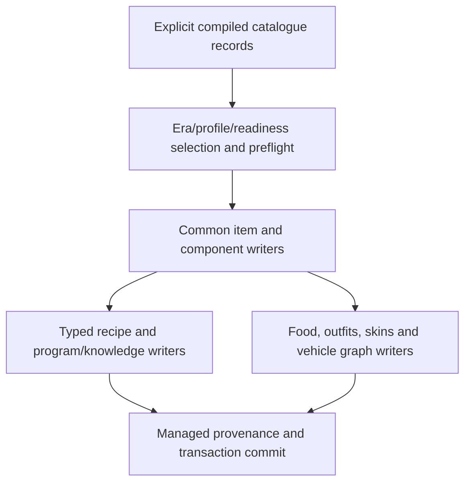

# ItemSeeder

ItemSeeder uses one era-independent, typed C# catalogue for items, recipes and specialised graphs. Fixed variants are authored records. Era, module, readiness, evidence and dependency metadata determine admission; they do not select different authoring formats. No Python generator, TSV parser, external ownership manifest or SQL sidecar is required to build or run the installer. See the [implementation results](../ItemSeeder_Unified_Catalogue_Completion_Results.md) for qualification evidence and remaining platform limits. Earlier [stages 1–2](../ItemSeeder_Unified_Catalogue_Stage12_Results.md) and [first stage 3 batch](../ItemSeeder_Unified_Catalogue_Stage3_Results.md) are historical checkpoints.

## Start here to add content

The authority is [Catalogue](../../../DatabaseSeeder/Seeders/ItemSeeder/Catalogue). Content assemblies depend on the catalogue contracts and shared domain types, not on the installer. Each factory returns literal data; bounded selection methods enumerate those factories in the required order. The ordinary build compiles checked-in C# directly. Compatibility projections serve existing validators and persistence writers; they are not a second content source.

| Content | Authoritative definition | Selection/application |
| --- | --- | --- |
| Ordinary historical items and aliases | `Assemblies/Historical*/Content` and `HistoricalSpecs*/Content`, `CatalogueItemDefinition` and explicit spec/alias records | Owning `Compiled*Catalogue` selection; common item writer |
| Industrial ordinary items and price evidence | `Assemblies/Industrial01`–`Industrial04/Content`, `CatalogueItemDefinition` and `CataloguePriceEvidenceDefinition` | Existing technology-profile binding, dependency and ownership validation |
| Medical and repair | `Assemblies/Medical/Content`, explicit item records | `CompiledStockCatalogue` projection and medical prerequisite validation |
| Recipes | `Assemblies/Recipes*/Content`, `CatalogueRecipeDefinition` | Explicit `CompiledRecipeSelection*` batches; typed recipe XML writer and common craft persistence |
| Recipe access gates and selector programs | `Assemblies/Contracts/CatalogueRecipeGates.cs`, `NativeCatalogueRecipeGates.cs`, `Assemblies/RecipeSupport/Content` | Shared gate/program/knowledge ownership writers |
| Prepared food and liquids | `Assemblies/Food*/Content`, `CatalogueFoodDefinition` and literal liquid definitions | `CompiledFoodCatalogue`; existing component, freshness and liquid writers |
| Clothing physical sources | `Assemblies/ClothingSources*/Content`, explicit clothing admission records | `CompiledClothingSources`, physical identity and colour validation |
| Outfits and skins | `Assemblies/Outfits*/Content`, `CatalogueOutfitDefinition`; literal skin definitions | `CompiledOutfitCatalogue`; owned template/entry/skin writers |
| Vehicles | `Assemblies/Vehicles/Content`, complete `CatalogueVehicleDefinition` graphs | `CompiledVehicleCatalogue`; vehicle graph persistence and ownership |
| Industrial technology, food and clothing research | `Assemblies/IndustrialGraphs*`, typed graph records | Existing profile, dependency and readiness validators; migration does not activate developmental data |
| Planning and research metadata | `Assemblies/ProductionPlans/Content` and explicit research definitions | Inspection/audit only unless explicitly admitted |

Use the [item authoring guidelines](../../Items/Item_Authoring_Guidelines.md), [item content workflows](../../Items/Item_System_Content_Workflows.md), and [craft guide](../../Items/ItemSeeder_AddCraft_Guide.md) for narrative and runtime contracts. The craft guide's compact-string API remains an importer/developer compatibility surface; stock catalogue recipes author typed inputs, tools, phases and success/failure products.

For a new record:

1. Choose a stable identity and the owning domain. Preserve existing keys and aliases when revising stock. Record evidence, source notes, dependency/admission metadata and readiness alongside physical data.
2. Add explicit literal records for every fixed variant. Keep decimal scale, units, notes, quality, material, tags, components, lifecycle references and profile bindings. Runtime composition is reserved for actual installer/player choices, such as technology profile bindings or copied input colour.
3. Add the factory to the owning explicit selection batch in its intended order. Recipe order determines shared gate/knowledge creation order; do not casually sort the stock dispatch. Maintain the tested user-string heap budget below 4 MiB per content assembly; split a batch before exceeding it.
4. For a recipe, supply typed inputs/tools/products and an explicit gate. Preserve input order, variable input indices, failure routing, quality policy and phase references. Use ordered `CheckTraitChoices` where the original recipe selects a configured specialist skill before a fallback; a shared knowledge gate does not determine the recipe's check skill. Resolve output prototypes by stable reference. Fixed stock recipes do not derive quantities or materials from later builder edits to item prototypes.
5. For food, author nutrition, taste, serving scope, bites, freshness thresholds/multipliers, ingredients and admission profile. For clothing/outfits, author the real physical base, wear profile, load arguments, placement, order and optional skin; do not flatten these into item-only data. For vehicles, author the entire compartment/control/access/cargo/propulsion/damage graph.
6. Run the owning semantic/ownership tests and update the compiled inventory and inspection exports described below. Review intended count changes rather than weakening frozen parity fixtures. Original-binary fixtures preserve the migration baseline; they are not regenerated as a routine content-authoring step.

Legacy generators and TSV/reference tables remain historical evidence or explicitly invoked import/audit fixtures. Editing them does not change live compiled stock. No generator is part of the build. No runtime reflection discovers item variants.

## Purpose, choices and prerequisites

`ItemSeeder` (`Name = "Items"`) is discovered through `IDatabaseSeeder`; no manual Program registration is required. Its question contract is unchanged: `eras`, conditional `technologyprofile`, five custom technology bindings, and rerun `scope` (`all` or `blackpowder`). `ResolveSelectedEras` merges installed and requested eras; narrowing a request does not uninstall previously selected stock.

Antiquity, Medieval, Renaissance, Early Modern and Industrial retain their registry admissions. Modern, Nuclear and Information remain non-selectable; retained later-era vehicle/research records do not activate them. Industrial food remains dependency-reviewed and its production-readiness gate still blocks unsupported activation. Industrial clothing's 13 source tables were header-only; their migrated graph is empty rather than invented garment content.

Metadata and domain preflights require the appropriate Core, attributes/skills, Human, Useful, Animal, combat and Health foundations. Exact materials, tag paths, components and traits must exist. Technology profiles retain their remembered immutable choices. The dependency map's ordering hints cannot replace database predicates.

## Execution, writes and ownership

`SeedData` loads a cached compiled ownership inventory, resolves eras, begins a relational transaction, initializes caches, validates dependencies, creates selected items and specialised content, flushes item identities, installs typed recipes/programs/knowledge and vehicles, retires missing owned definitions, then commits. Capture-only execution rolls back its relational transaction. Exceptions propagate and roll back; in-memory fixtures cannot prove relational rollback.

`CreateItem` registers the complete definition, resolves stable identity or a narrowly eligible legacy exact match, allocates editable revisions and writes item/tag/component links. Missing low-level prerequisites can prevent individual source-only payloads from becoming installed items. Qualification therefore compares actual native installations as well as synthetic inventories.

Durable `SeederManagedRecords` retain entity type/key, logical ID/revision, applied fingerprint and retirement state. Untouched owned stock can update. Builder-modified items, crafts and rich aggregates remain customised; unmanaged identity/signature conflicts block. Retirement changes provenance, not world entities. Prepared-food reconciliation now honours the common writer's customisation result before assigning fields. Generated spoilage-rule identities are flushed and bound in the same transaction. A legacy zero-ID binding is repaired only when its unique live rule still matches the recorded complete stock fingerprint; ambiguous or customised candidates fail closed.

MySQL can return an item's decimal price at a different scale from its authored literal. Ownership comparison accepts that representation change only when the numeric price is identical and the complete live definition, with that scale alone adjusted, matches the recorded stock fingerprint. Authored decimal literals and canonical fingerprints remain unchanged. Genuine price or description changes still protect customised content. Recipe selector programs are saved as one batch before product XML captures their permanent IDs; a nonpositive selector ID blocks installation. Independent fresh databases may allocate different program IDs, so differential fresh-install checks resolve unique program identities and validate complete persisted signatures. Upgrade and unchanged-rerun checks require exact existing IDs and fingerprints.

Outfit reconciliation resolves live item names/revisions once per batch, including tracked builder renames. This avoids repeated tracked-graph scans while preserving the live ownership signature. Item/component/tag caches similarly avoid repeated whole-catalogue lookup work.

Resolving an existing tag path replays its leaf-name bindings in creation order, including homonyms. It retains already-owned parent tags without claiming unowned parents or rewriting their provenance. A parent ownership ID mismatch blocks reconciliation.

The original native installer suppresses a second tall leather arrow-quiver definition because both recipes share one craft key. The first registered recipe remains stock. `SuppressedLegacyRecipeVariants` preserves the hidden Kushite definition as dependency-reviewed data for a future deliberate identity decision. Thirty-six recipes found only in the earlier incomplete synthetic capture are also retained as inactive research, and their existing ownership records are protected from retirement. Neither category is silently activated or discarded.

## Inventory, distribution and verification

`Seeded_Item_Manifest.json` is an inspection/provenance export, not a runtime parser input. The compiled inventory currently has 43,825 aggregates: 23,572 items, 14,040 crafts, 2,609 components, 1,425 programs, 1,313 outfits and the remaining liquid, vehicle, knowledge, tag, material, spoilage, skin and variable records. The larger recipe total corrects omissions in the original synthetic capture; it does not activate new eras.

After changing catalogue definitions, run `--export-compiled-item-inventory`, rebuild, run `--capture-item-manifest-in-memory`, and run `--check-item-manifest`. The first command writes checked-in bounded inventory C# from the selected definitions; the second captures the inspection JSON with the current source fingerprint. These are explicit developer refresh operations, not build or installation prerequisites. Review both diffs and source/identity parity. Relational capture uses the protected `FUTUREMUD_ITEM_MANIFEST_CONNECTION_STRING` environment variable; positional credentials are rejected.

The normal runtime reads the compiled inventory with no repository search, file hashing or JSON parse. Blank-database SQL and its SHA/migration metadata are embedded resources. Bootstrap retains the native import fast path, materializing an owned temporary SQL file and cleaning it on success or failure; EF migration fallback remains available. Single-file publication embeds managed/native dependencies, strips development sidecars and selectively precompiles bounded catalogue assemblies. Framework-dependent publications still require the declared .NET runtime. The installer can create configuration, launcher and backup outputs during normal setup; these are outputs, not shipped dependencies.

Run the full seeder suite and relevant persistence tests. Use real MySQL first install, unchanged rerun, legacy upgrade, staged era additions, customisation/rename preservation, missing-link repair, permanent IDs and rollback checks. For construction-path changes, exercise actual runtime craft products, food ageing/XML reload, wearable profile resolution and vehicle graph references. Source hashes and insertion counts alone do not prove these behaviours. The [completion results](../ItemSeeder_Unified_Catalogue_Completion_Results.md) distinguish completed checks, failed/superseded attempts, performance evidence and unavailable native platforms.

See the [shared execution contract](README.md#shared-execution-contract), [dependency map](Dependency_Map.md), and [coverage matrix](Coverage_and_Evidence.md).
